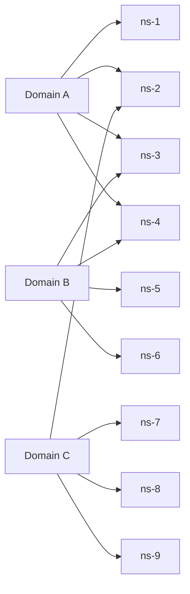

## The problem

Amazon Route 53 hosts DNS for a huge number of customer domains on shared servers. If one domain is hit by a massive DDoS attack, or a customer sends a "poison" request that crashes servers, every domain on those servers suffers.

Putting dedicated DDoS scrubbing hardware in front of every domain would have cost tens of millions of dollars. The team wanted a design where the impact of any single customer's problem stays tiny, without dedicating servers to each customer.

## From sharding to shuffle sharding

Start with 8 workers and many customers.

- **No sharding:** every customer uses all 8 workers. One bad customer affects everyone.
- **Regular sharding:** split the workers into 4 shards of 2. A bad customer takes down its shard, affecting 25% of customers.
- **Shuffle sharding:** give each customer its own random pair of workers. With 8 workers there are **28 possible pairs**. A bad customer takes down its two workers, but most other customers share at most one worker with it, and still have a working one. Only the customers with the exact same pair are fully affected: about 1 in 28.

Clients must retry against the other servers in their shard when one fails; that's what turns overlap into survival.

## At Route 53 scale

Route 53 uses **2,048 virtual name servers**, and each customer domain is assigned a **shuffle shard of four** of them. That gives roughly **730 billion** possible combinations. Assignment ensures that no two domains share more than two name servers. So even if an attack takes out all four servers for one domain, every other domain still has at least two working name servers, and DNS resolvers automatically retry against the ones that answer.

If domain A is attacked and ns-1 to ns-4 fail, domain B still has ns-5 and ns-6, and domain C still has three servers.

## What to take away

<Callout type="tip" title="Key takeaways">
- **Shuffle sharding multiplies isolation without multiplying hardware.** Combinations grow far faster than the number of servers.
- **It needs fault-tolerant clients** that retry against the other members of their shard.
- **It protects against bad tenants,** whether attacks, poison requests or runaway workloads, in any multi-tenant service.
- **Combine with cells** for protection against infrastructure failures as well as tenant-caused ones.
</Callout>
