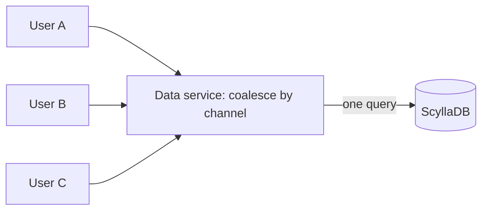

## The problem

Discord stores every message ever sent in every server and DM, and users expect to scroll back through years of history instantly. By 2017 the message store had outgrown a single MongoDB replica set: the data and indexes no longer fit in RAM and latency became unpredictable.

The access pattern shaped every decision that followed: **messages are read and written per channel, almost always the most recent ones first**, and a handful of very large servers generate a hugely disproportionate share of traffic.

## Step 1: Cassandra and the partition key (2017)

Discord moved to Cassandra, a wide-column store built on [LSM trees](/principles/lsm-trees-vs-b-trees) that handles heavy write loads well. The key design decision was the partition key:

```text
PRIMARY KEY ((channel_id, bucket), message_id)
```

- `channel_id` keeps a channel's messages together, so reading recent history is a single-partition query.
- `bucket` is a fixed window of time (about 10 days). Without it, a busy channel's partition would grow forever.
- `message_id` is a time-ordered Snowflake ID, so messages within a partition are already sorted.

This is [data modeling for the query](/principles/data-modeling-and-denormalization): the table is shaped around the one read that matters most.

## Step 2: the cluster struggled under hot partitions

By 2022 the cluster had grown to **177 nodes holding trillions of messages**, and it had become high-toil and unpredictable:

- **Hot partitions.** When a huge server had an announcement, thousands of users read the same channel at once. All of those reads landed on the same few nodes, and because Cassandra reads cost more than writes, latency spiked for *every* query those nodes served, not just that channel.
- **Compaction backlogs.** Cassandra's background compaction fell behind, making reads even more expensive.
- **Garbage-collection pauses.** JVM GC pauses caused significant latency spikes, and sometimes required operators to manually reboot nodes.

## Step 3: a data-services layer that coalesces requests

Before switching databases, Discord added an intermediate service, written in Rust, between the API and the database. Its most important feature is **request coalescing**: if many users ask for the same channel's messages at the same moment, only **one** query goes to the database and every waiting request shares the result.



Requests are routed to data-service instances by channel ID with consistent hashing, so all requests for one channel arrive at the same instance and can be coalesced. This is the same idea as the leases used to prevent a [cache stampede](/principles/cache-stampede), applied in front of a database.

## Step 4: migrating to ScyllaDB

ScyllaDB is a Cassandra-compatible database written in C++, so it has no garbage collector, and it uses a shard-per-core architecture. Discord moved its other, smaller databases to it first to learn how it behaved, then migrated the message store:

- A migrator written in Rust copied data at up to **3.2 million messages per second**, finishing the migration in **9 days**.
- The new cluster runs on **72 nodes instead of 177**, each with more disk.
- **p99 read latency fell from 40–125 ms to about 15 ms**, and p99 insert latency from 5–70 ms to a steady 5 ms.

During the 2022 World Cup final, message spikes from goals showed up clearly in the traffic graphs while latency stayed flat.

## What to take away

<Callout type="tip" title="Key takeaways">
- **Pick the partition key from the dominant query**, and bound partition size with a time bucket.
- **Hot partitions are a traffic problem as much as a data problem.** Coalescing duplicate reads protected the database regardless of which engine sat underneath.
- **Tail latency often comes from the runtime.** GC pauses and compaction debt, not average query cost, drove the worst user experience.
- **Migrate with a fast, verifiable copy.** A purpose-built migrator turned a months-long risk into a nine-day project.
</Callout>
