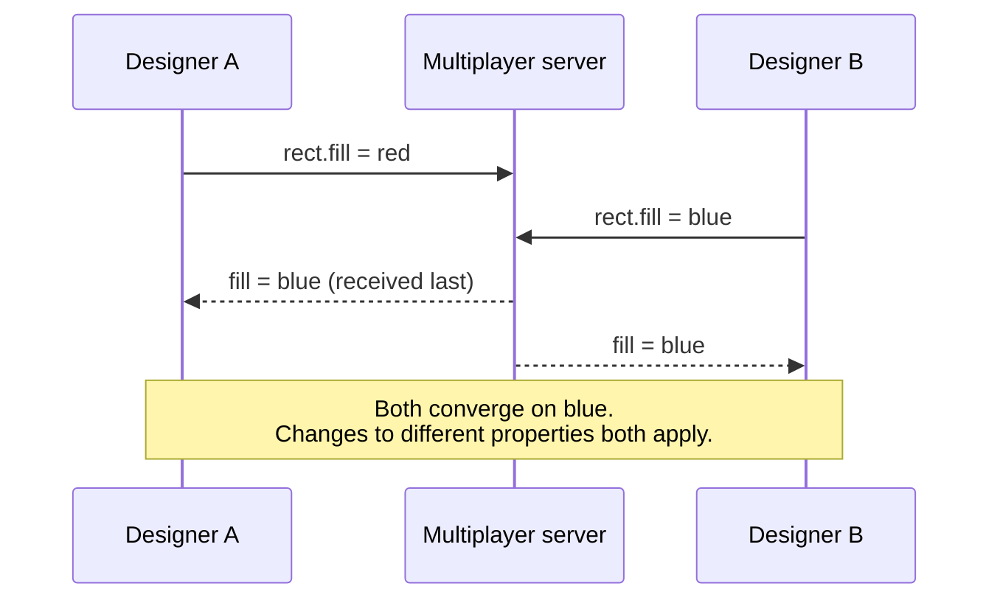

## The problem

In Figma, several designers can drag, resize and recolor the same objects at the same time, and everyone needs to see a consistent document within milliseconds. Edits can conflict: two people change the same rectangle's color at once, or one deletes a frame while another moves something into it.

Google Docs-style collaboration uses **operational transformation** (OT), which rewrites concurrent edits so they can be applied in any order. OT is powerful but notoriously complex, and Figma isn't a text editor: it's a tree of objects with properties.

## The design

### A server per document

When a document is open, clients connect over WebSockets to a multiplayer server process that holds that document in memory. **The server is the authority**: it decides the order in which changes are applied and broadcasts them to all connected clients.

Because one server orders all changes for a document, Figma doesn't need the decentralized machinery that pure CRDTs (conflict-free replicated data types) use to converge without coordination. It borrows CRDT ideas, but keeps a central referee.

### Last writer wins, per property

The document is a tree of objects, and each object is a map of properties (`x`, `width`, `fill`…). Conflicts are resolved **per property**:

- If two people change **different properties** of the same object, both changes apply.
- If two people change the **same property**, the one the server receives last wins.

Clients apply their own edits immediately for responsiveness. While a local change is still waiting for the server to acknowledge it, the client ignores incoming server updates to that same property, so the user's own edit doesn't flicker back to an older value.

### The tricky cases

- **Ordering children:** objects in a layer list are ordered by **fractional indexing**: each child has a position like 0.5 between neighbours at 0 and 1, so inserting between two items never requires renumbering others.
- **Reparenting:** if two people move objects so each would become the other's parent, the server rejects the change that would create a cycle.
- **Creation and deletion:** object existence is treated like another last-writer-wins property.

## Reliability

Because document state lives in a server's memory, Figma later described adding a journal: every change is written to a durable log before being acknowledged, so a crashed server can recover recent edits instead of relying on periodic checkpoints alone.

## What to take away

<Callout type="tip" title="Key takeaways">
- **Pick the simplest consistency model your product can live with.** Per-property last-writer-wins is easy to reason about and fits a design tool.
- **A central authority simplifies conflict resolution.** You trade some availability (the server must be up) for much simpler logic.
- **Optimistic local updates make it feel instant,** with the server's ordering as the final word.
- **Durability needs a log,** not just in-memory state.
</Callout>
