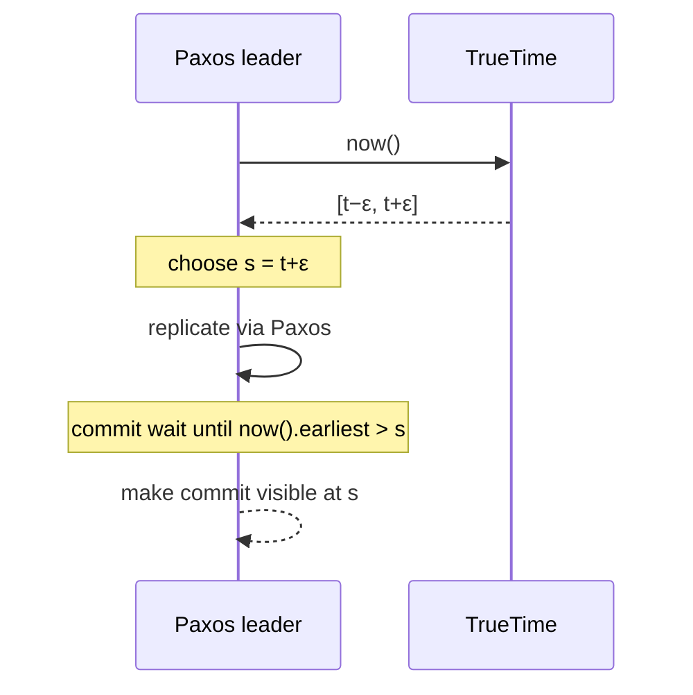

## The problem

Google's advertising business ran on a sharded MySQL setup that was painful to reshard and couldn't offer transactions across shards. Bigtable scaled well but lacked strong consistency across rows, and teams kept building complicated workarounds on top of it.

Google wanted a database that scaled across datacenters on several continents **and** gave applications SQL-like transactions with strong guarantees.

The hard part is ordering. To give transactions a global order, every machine needs to agree on which happened first. But clocks on different machines drift, and normally nobody knows by how much.

## TrueTime: admitting uncertainty

Instead of pretending clocks are exact, Spanner's **TrueTime** API returns an **interval**:

```text
TT.now() → [earliest, latest]
```

The real time is guaranteed to be somewhere inside the interval. To keep the interval narrow, each Google datacenter has time servers with **GPS receivers and atomic clocks** (two independent sources that fail differently), and every machine polls them regularly. The paper reports the uncertainty ε was typically between about 1 and 7 milliseconds.

## Commit wait

When a transaction commits, Spanner:

1. Picks a commit timestamp `s` no earlier than `TT.now().latest`.
2. **Waits** until `TT.now().earliest > s`, meaning `s` is definitely in the past on every clock.
3. Only then makes the commit visible.

The wait is about 2ε, usually a few milliseconds. In exchange, if transaction A commits before transaction B starts anywhere in the world, A's timestamp is guaranteed to be lower than B's. Google calls this **external consistency**, which is equivalent to linearizability for transactions.



## The rest of the design

- Data is split into ranges, each replicated across zones and regions by its own **Paxos** group with a leader.
- Transactions spanning groups use **two-phase commit**, with each participant being a fault-tolerant Paxos group rather than a single machine.
- Because every version has a meaningful global timestamp, **read-only transactions and snapshot reads** run without locks at any replica that's caught up to the requested time.

## What to take away

<Callout type="tip" title="Key takeaways">
- **Bounded uncertainty beats false precision.** Knowing how wrong your clock might be lets you build correct protocols on top of it.
- **Hardware can simplify distributed algorithms.** GPS and atomic clocks turned a hard ordering problem into a short wait.
- **Strong global consistency costs latency.** Every write pays a Paxos round and a commit wait, a clear PC/EC choice in [PACELC](/principles/pacelc) terms.
- **Without such clocks, use logical ordering.** Most systems rely on consensus or hybrid logical clocks instead of physical time.
</Callout>
