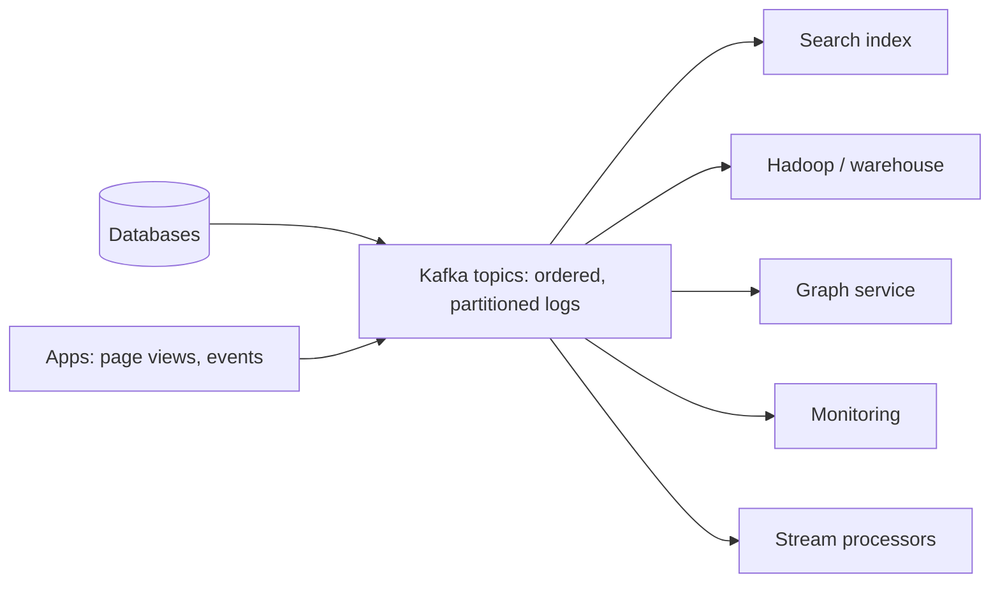

## The problem

By the late 2000s, LinkedIn had many specialized systems: the main databases, a search index, a social graph service, caches, a Hadoop data warehouse, monitoring, recommendation systems. Each needed data from the others, and each connection was a custom pipeline.

With *N* systems that all need each other's data, you end up with up to *N²* pipelines, each with its own format, failure modes and lag. Adding a new system meant building new pipelines to everything it needed.

## The idea: the log

Jay Kreps, one of Kafka's creators, described the core abstraction in a widely read 2013 essay. A **log** is the simplest possible storage structure:

- **Append-only:** records are only ever added at the end.
- **Ordered:** each record has a sequential position (an offset), which acts as a notion of time.
- **Durable and replayable:** consumers read from any position, at their own pace, and can re-read history.

Databases already use logs internally (write-ahead logs, replication logs). The insight was to make the log a **first-class, shared service** that every system can publish to and read from.

## The design: Kafka

- Producers append records to **topics**, which are split into **partitions** for parallelism; order is guaranteed within a partition.
- Each consumer group tracks its own **offset**, so a slow batch job and a real-time service can read the same topic independently.
- Data is retained for a configured time (or compacted to the latest value per key), so new consumers can bootstrap from history.
- Partitions are replicated across brokers for durability.

N² pipelines became 2N connections: each system writes to the log and reads from it.

## Why it mattered

- **Data integration:** one pipeline per system instead of one per pair.
- **Stream processing:** systems such as Samza (also from LinkedIn) process the log continuously, computing derived data in real time.
- **Change data capture:** database changes published to the log keep caches, search indexes and warehouses in sync. See [event sourcing](/principles/event-sourcing).
- **Decoupling:** producers don't need to know who consumes their data, or be available when they do.

Kafka was open-sourced in 2011 and became an Apache project; it's now used across most of the industry.

## What to take away

<Callout type="tip" title="Key takeaways">
- **A shared log turns N² integrations into 2N.**
- **Logs differ from queues:** consumers keep their own position and can replay; messages aren't deleted when read.
- **Order per partition, not globally.** Choose partition keys so related events stay in order.
- **Derived data can be rebuilt** by replaying the log, which makes new systems and recovery much easier.
</Callout>
