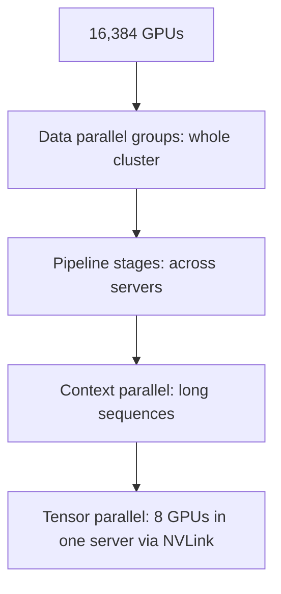

## The problem

Llama 3's largest model has 405 billion parameters and was pre-trained on more than 15 trillion tokens. That's far beyond what any single machine can do: the training needed thousands of GPUs working in lockstep for months, where a single failure can stop all of them.

## The infrastructure

In March 2024, Meta described two clusters of **24,576 H100 GPUs** each, built for generative AI. They were identical except for the network: one used **RDMA over Converged Ethernet (RoCE)** and the other **NVIDIA Quantum-2 InfiniBand**, both with 400 Gbps endpoints. Meta built both to learn how each fabric behaved at scale, and reported tuning them to deliver equivalent performance for its workloads. The largest Llama 3 training runs used up to **16,384 GPUs**.

## Four kinds of parallelism

The Llama 3 paper describes **4D parallelism**, combining:

1. **Tensor parallelism:** splitting each layer's matrix operations across GPUs within a server, where NVLink provides the most bandwidth.
2. **Context parallelism:** splitting very long sequences across GPUs so attention fits in memory.
3. **Pipeline parallelism:** assigning groups of layers to different servers, with micro-batches flowing through the pipeline.
4. **Fully sharded data parallelism:** replicating the whole arrangement across the cluster, with weights, gradients and optimizer state sharded to save memory.

The dimensions are ordered so the most communication-heavy (tensor parallelism) stays inside a server, and the least (data parallelism) spans the whole cluster, matching the network's bandwidth hierarchy. Meta reported **38–43% model FLOPs utilization**, the share of the GPUs' theoretical compute actually used.

## Failures were the norm

The paper is unusually candid about reliability. During a **54-day** snapshot of pre-training, the job had **466 interruptions**:

- 47 were **planned** (such as maintenance and configuration changes).
- **419 were unexpected**, about one every three hours.
- In Meta's breakdown, **faulty GPUs** were the largest single cause (about 30%), followed by **GPU HBM3 memory** (about 17%). Network switches and cables, software bugs and host maintenance made up much of the rest; only two CPU failures occurred.

Even so, the team reported **more than 90% effective training time**. Significant manual intervention was needed only **three times**; automated systems detected failures, identified bad hosts and restarted the job from checkpoints. Meta also built tooling to find **stragglers**, slow but not failed GPUs that drag down the whole synchronous job, and noted environmental effects such as throughput varying with daytime temperature.

## What to take away

<Callout type="tip" title="Key takeaways">
- **Match parallelism to network topology.** Put the chattiest communication on the fastest links.
- **At scale, hardware failure is a constant, not an exception.** Design the training loop around detection, checkpointing and fast restarts.
- **Automation is the only way to keep goodput high.** Three manual interventions in 54 days is what good tooling buys.
- **Measure effective training time,** not just peak speed.
</Callout>
