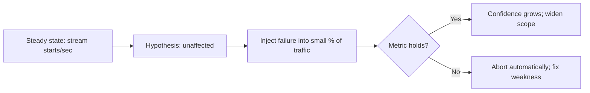

## The problem

In 2008 a major database corruption stopped Netflix from shipping DVDs for three days. The company decided to move from its own data centers to AWS, built from many small, horizontally scaled services instead of a few big vertically scaled systems.

In the cloud, individual instances can disappear at any time. Netflix's engineers realized the only way to be confident their services would survive that was to make failure happen **constantly**, on purpose, while engineers were at work to see it.

## Chaos Monkey

Chaos Monkey randomly terminates virtual machine instances in production during business hours. If a service can't survive losing an instance, the team finds out on a weekday afternoon, with everyone around, rather than at 3 a.m. during a real failure.

The effect on design was the real goal. Knowing instances would be killed every day, teams built services to be stateless, redundant and automatically replaced, with clients that time out and retry against other instances.

## The Simian Army

In 2011 Netflix described a growing set of tools:

- **Chaos Gorilla** simulates the loss of an entire AWS **availability zone**.
- **Latency Monkey** injects artificial delays into calls between services, to test how clients handle slow dependencies.
- **Conformity Monkey** and **Security Monkey** find instances that don't follow best practices or have security problems.
- **Janitor Monkey** cleans up unused resources.

Later, **Chaos Kong** exercised evacuating an entire AWS **region**, shifting all of Netflix's traffic to the remaining regions. This turned out to be vital: when an AWS region had serious problems, Netflix could move its customers away.

## From tools to a discipline

Netflix generalized the practice into **chaos engineering**, defined on principlesofchaos.org:

1. Define a **steady state**: a measurable signal of normal behaviour, such as stream starts per second.
2. Hypothesize that the steady state will continue in both the control group and the experiment group.
3. Introduce real-world events: server crashes, latency, network partitions, region failures.
4. Try to disprove the hypothesis by comparing the groups.

Netflix later built more targeted tooling that injects failures into a small percentage of real user requests and automatically stops the experiment if the steady-state metric drops.

## What to take away

<Callout type="tip" title="Key takeaways">
- **Failure you practise is failure you survive.** Regularly killing instances forced every team to design for it.
- **Start small and in business hours.** Chaos experiments need a limited blast radius and people ready to respond.
- **Measure user-facing steady state,** not CPU or error logs, to decide whether an experiment hurt anyone.
- **Scale up the failures over time:** instance, then zone, then region.
</Callout>
