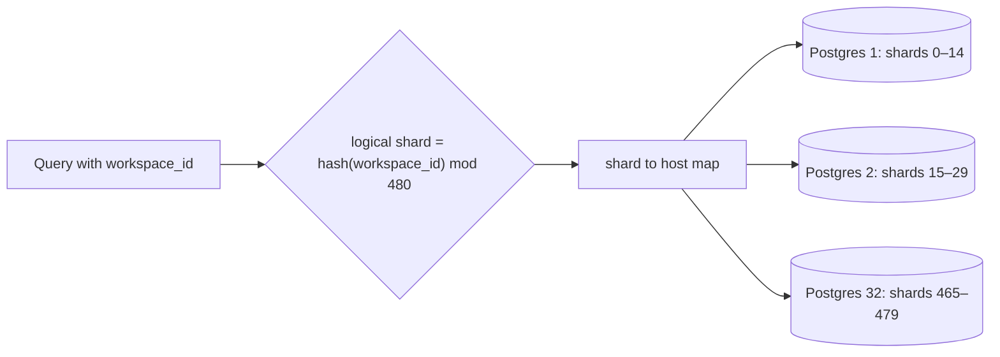

## The problem

Every block in Notion (a paragraph, a to-do, an image) is a row in the database, so the data grows quickly. By 2020, Notion's single PostgreSQL database was under strain: CPU spiked under load, and **VACUUM**, Postgres's background cleanup, struggled to keep up, which risked transaction ID wraparound, a condition where Postgres stops accepting writes to protect data.

Buying a bigger machine had run its course. Notion decided to shard.

## Choosing the shard key

Almost every query in Notion is scoped to a single **workspace**. Partitioning by workspace ID means:

- A page load touches one shard.
- Permissions and related blocks live together.
- Cross-shard queries are rare.

## Choosing the number of shards

Notion's constraints included keeping each table under about 500 GB and each physical database under about 10 TB, with room to grow. They chose **480 logical shards across 32 physical databases** (15 per database). 480 has many divisors, so it can be spread evenly across 8, 16, 32, 48, 96 or many other numbers of machines later without splitting a logical shard.

In 2023 they did exactly that, expanding to 96 physical databases with 5 logical shards each, while keeping the 480 logical shards unchanged.

## Migrating without downtime

1. **Double-write:** new writes went to both the old database and the new shards.
2. **Backfill:** existing data was copied to the shards in the background.
3. **Verify:** Notion compared data between the old and new systems, including running reads against both and checking the results matched.
4. **Switch over:** after verification, Notion moved traffic to the shards during a short scheduled maintenance window of about five minutes.

## What to take away

<Callout type="tip" title="Key takeaways">
- **Shard by the key your queries already use.** For a multi-tenant product, tenant or workspace ID usually wins.
- **Choose a logical shard count with many divisors** so you can re-balance across more machines without re-sharding.
- **Migrate in verifiable steps:** double-write, backfill, compare, then switch.
- **Don't wait too long.** Notion noted it would have been easier to shard before the database was under severe strain.
</Callout>
