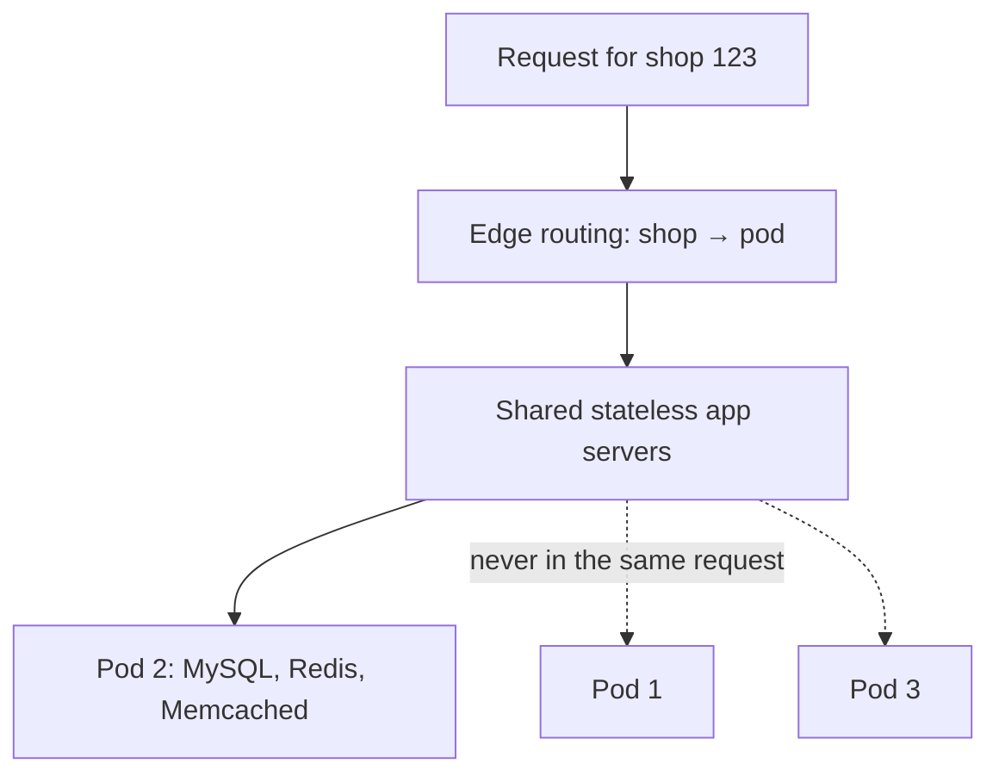

## The problem

Shopify hosts hundreds of thousands of merchants on one platform. Traffic is spiky: a celebrity product drop or a Black Friday sale can multiply load on a single store in seconds.

By 2015, Shopify could no longer buy a bigger database server, so it **sharded** its MySQL database by shop. That fixed capacity, but not resilience. Requests still depended on shared resources:

- If any one shard was unhealthy, actions that touched it could fail across the platform.
- A shared **Redis** instance used by every shop had an outage that took down all of Shopify, an incident engineers nicknamed "Redismageddon".

Sharding had spread the data, but everything still shared fate.

## The design: pods

In 2016 Shopify introduced **pods**. A pod is a group of shops with its own, fully isolated set of datastores: MySQL, Redis, Memcached and so on.

- **Stateful resources are per pod.** Nothing stateful is shared between pods.
- **Stateless resources are shared.** App servers, job workers and load balancers can serve any pod, but each request or background job talks to **exactly one pod**.
- **Routing:** an edge layer looks up which pod a shop lives in and routes the request accordingly.
- **Moving shops:** tooling can move a shop from one pod to another without downtime, which is how Shopify balances load and isolates very large merchants.

A failure in one pod's database or cache now affects only the shops in that pod. Pods also became the unit for running Shopify across multiple regions: each pod can be active in one region with a replica in another, and failed over independently.

## What to take away

<Callout type="tip" title="Key takeaways">
- **Sharding spreads load; cells contain failures.** You usually need both.
- **Isolate stateful dependencies, share stateless ones.** That keeps the cost of isolation low.
- **One request, one cell.** If a request can only touch one pod, a pod failure has a bounded blast radius.
- **Make tenants movable.** The ability to move a shop between pods turns hot spots into an operational task rather than an emergency.
</Callout>
