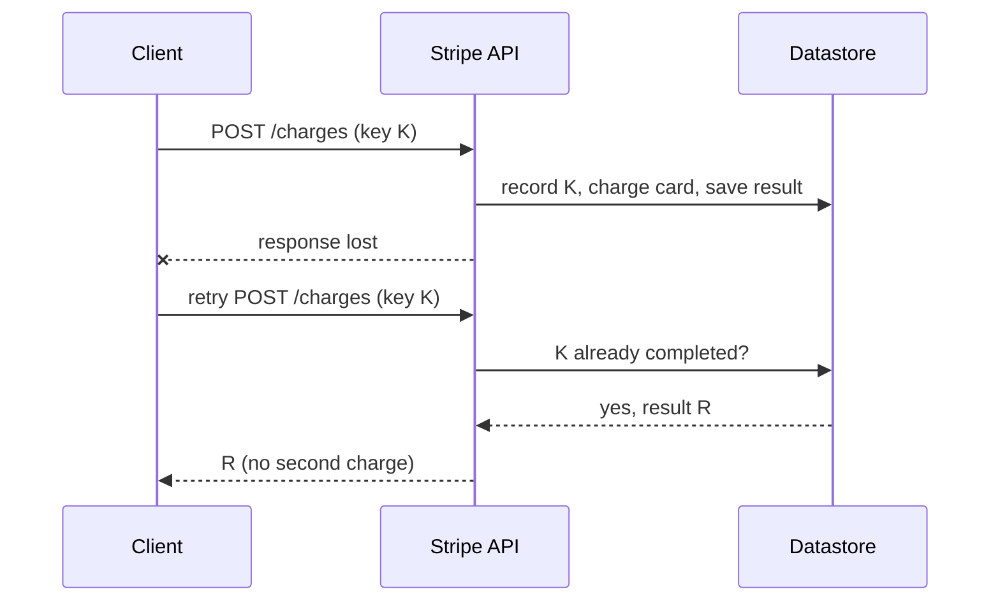

## The problem

A client sends `POST /v1/charges` and the connection drops before a response arrives. Three things could have happened:

1. The request never reached Stripe.
2. Stripe processed it and charged the card, but the response was lost.
3. Stripe crashed partway through.

From the client's side these look identical. Retrying risks charging the customer twice; not retrying risks never charging them. For a payments company, neither is acceptable.

## The design

**GET** and **DELETE** requests are naturally idempotent: doing them twice has the same effect as once. Creating a charge is not. Stripe makes it idempotent with a client-supplied key:

```http
POST /v1/charges
Idempotency-Key: 6a1f9c2e-6b1d-4c8e-9a51-3f0e2d1b7c44
amount=2000&currency=usd&source=tok_visa
```

- The client generates a unique key (such as a UUID) for each logical operation, and reuses it on every retry of that operation.
- The first time Stripe sees the key, it processes the request and **stores the result against the key**.
- If the same key arrives again, Stripe returns the **stored result** without doing the work again.
- If the original request is still in progress, the retry is told so, rather than starting a parallel attempt.



## Retrying well

Stripe's client libraries retry failed requests automatically, reusing the idempotency key, and use **exponential backoff with random jitter** between attempts. Backoff stops a fleet of clients from hammering a struggling server in lockstep; jitter spreads their retries out so they don't all arrive at the same instant.

## The harder part: being idempotent internally

Storing a result is easy when the whole request is one database transaction. It's harder when a request touches other systems, like a card network. Brandur Leach, who wrote Stripe's post, has described breaking such requests into **atomic phases**: each phase commits its progress to the database with the key, so a retry can resume from the last completed phase rather than starting over or skipping steps.

## What to take away

<Callout type="tip" title="Key takeaways">
- **Any request can fail ambiguously.** Design mutating APIs so clients can safely retry them.
- **Let the client choose the key.** Only the client knows which requests are retries of the same operation.
- **Store the outcome atomically with the side effect,** so the key and the work can't get out of sync.
- **Pair retries with backoff and jitter** to avoid turning a partial outage into a full one.
</Callout>
