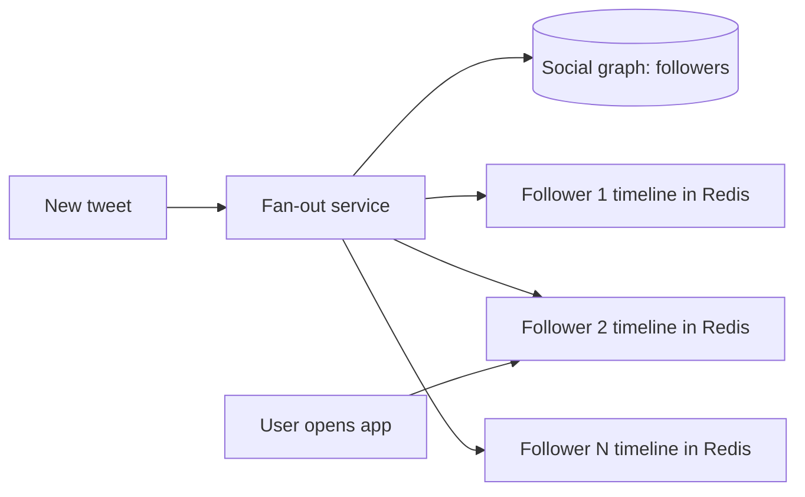

## The problem

When you open Twitter, your home timeline shows recent tweets from everyone you follow, newest first. The naive approach, querying the latest tweets from each followed account and merging them on every page load, is too slow and expensive when hundreds of thousands of timeline reads arrive every second.

In 2012, Twitter's Raffi Krikorian described the scale: about 150 million active users, timeline reads in the hundreds of thousands per second, and thousands of new tweets per second, many more at peaks.

Reads vastly outnumber writes, so Twitter optimized for reads.

## The design: fan-out on write

1. A user tweets. The tweet is stored once.
2. A fan-out service looks up the author's followers.
3. The tweet's ID is inserted into each follower's **home timeline**, a list kept in a Redis cluster, replicated for availability.
4. Reading your timeline is one lookup of a precomputed list, then hydrating the tweet IDs with content (from a separate cache).

Timelines hold a bounded number of recent entries (roughly 800 at the time), and only active users' timelines are kept in cache; inactive users' timelines are rebuilt on demand.

## The celebrity problem

Fan-out on write is expensive for accounts with tens of millions of followers: one tweet becomes tens of millions of cache writes, and delivery to the last followers can lag by minutes.

The standard fix, which Twitter discussed, is a **hybrid**: fan out on write for ordinary accounts, but for very high-follower accounts, skip the fan-out and **merge their recent tweets in at read time**. Most users follow only a handful of such accounts, so the read-time merge is cheap.

## What to take away

<Callout type="tip" title="Key takeaways">
- **Do the work on the cheaper side.** With reads far outnumbering writes, precomputing on write pays off.
- **Denormalized feeds trade storage and write cost for fast reads.** Store IDs, not full content, to keep the copies small.
- **Hybrid strategies handle skew.** Fan-out on write for most, fan-out on read for the few accounts with huge followings.
- **Cache only what's used.** Keeping timelines only for active users controls memory cost.
</Callout>
