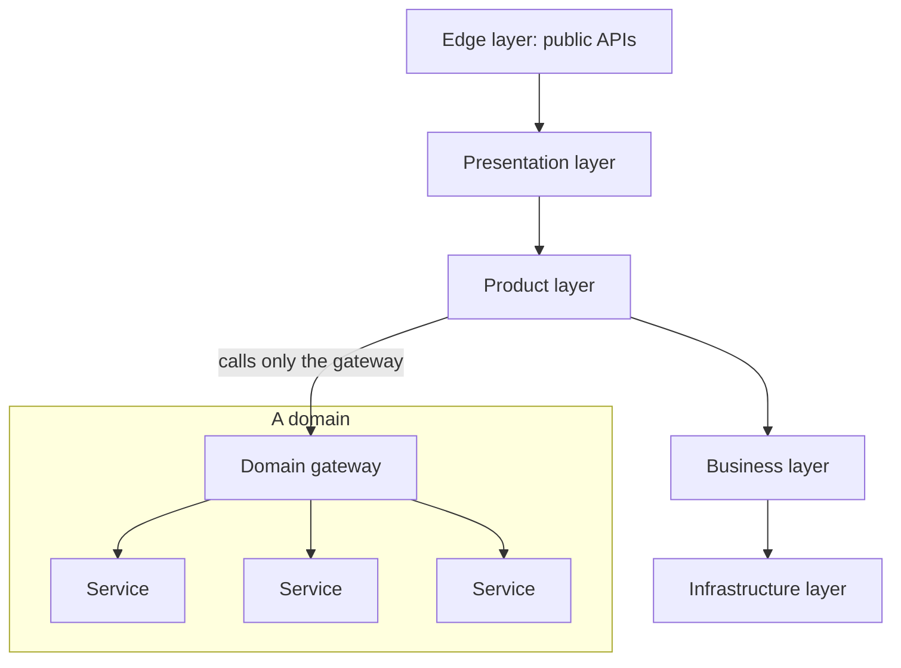

## The problem

Uber moved from a monolith to microservices early, which let hundreds of teams ship independently as the company grew rapidly. By 2020 it had around **2,200 critical microservices**.

The flexibility came with costs:

- Understanding what a request touched meant tracing through dozens of services.
- A single feature could require changes across many services owned by different teams, with coordinated releases.
- Services depended on each other freely, so dependency graphs became tangled, and a change in one place could ripple unpredictably.

## The design: DOMA

Uber's Domain-Oriented Microservice Architecture keeps microservices but adds structure on top:

- **Domains:** related services are grouped into a domain, for example everything about a particular part of the business. A domain might contain one service or many.
- **Gateways:** each domain exposes **one gateway** as its entry point. Other teams call the gateway's API, not the individual services behind it, so a domain can reorganize its internals without breaking callers.
- **Layers:** domains are organized into layers (from general infrastructure up through business logic, product features, presentation and edge). A layer may depend only on layers below it, which prevents cycles and limits the blast radius of changes.
- **Extensions:** instead of changing another team's domain to add a feature, teams plug logic into **extension points** the domain provides.

## Results Uber reported

- Fewer touch points to integrate new features.
- Platform teams could change their internal services without coordinating with every caller.
- Clearer ownership and smaller, more understandable dependency graphs.

## What to take away

<Callout type="tip" title="Key takeaways">
- **Microservices need structure at scale.** Grouping into domains with explicit interfaces restores some of the clarity a monolith had.
- **One gateway per domain** hides internal churn behind a stable API.
- **Layered dependencies** prevent cycles and make blast radius predictable.
- **Extension points beat cross-team changes** for adding product logic to shared platforms.
</Callout>
