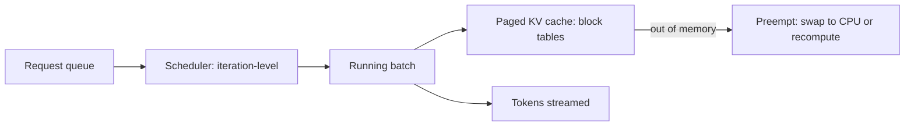

## The problem

In 2023, serving LLMs was expensive mainly because each GPU could only handle a few requests at once. The team at UC Berkeley that built vLLM traced the problem to memory, not compute.

Every active request needs a **KV cache** that grows with each generated token. Existing systems allocated one contiguous region per request, sized for the **maximum** possible output length, because they couldn't know in advance how long a response would be. The vLLM paper measured that in those systems only about **20–38% of KV cache memory held actual token data**. The rest was lost to:

- **Reservation:** space set aside for tokens not yet generated (and often never generated).
- **Internal fragmentation:** requests that ended far short of their maximum.
- **External fragmentation:** gaps between allocations too small to use.

Less usable memory meant smaller batches, and smaller batches meant poor throughput, since decoding is memory-bandwidth-bound and benefits enormously from batching.

## The design

### PagedAttention

The team applied **virtual memory paging** from operating systems to the KV cache:

- KV memory is divided into small fixed-size **blocks** (for example, 16 tokens each).
- Each request has a **block table** mapping its logical blocks to physical blocks anywhere in GPU memory.
- New blocks are allocated **only when needed** as the sequence grows.
- A new attention kernel reads keys and values through the block table.

Waste dropped to only the unused part of each sequence's last block: near zero.

### Sharing blocks

Because blocks are referenced indirectly, sequences can **share** them with copy-on-write. Parallel sampling (several outputs for one prompt) and beam search share the prompt's KV blocks instead of copying them, and later systems built prefix caching on the same idea.

### Scheduling

vLLM combined paged memory with **continuous batching**: requests join and leave the running batch at every decoding step. When memory runs out, it preempts some sequences, either swapping their blocks to CPU memory or dropping them to recompute later.

## Results

- **2–4× higher throughput** than state-of-the-art systems (FasterTransformer, Orca) at the same latency, with bigger gains for longer sequences, larger models and complex decoding like beam search.
- Released as open source, vLLM was quickly adopted by companies and cloud providers, and the paged KV cache became a standard technique across inference engines.

## What to take away

<Callout type="tip" title="Key takeaways">
- **Measure where the resource goes.** The breakthrough came from discovering most KV memory held nothing.
- **Old ideas transfer.** Virtual memory, invented for operating systems in the 1960s, solved a new problem in AI serving.
- **Memory efficiency is throughput.** For memory-bound workloads, fitting more requests in memory directly multiplies output.
- **Open-source infrastructure spreads fast** when it solves a costly problem everyone shares.
</Callout>
