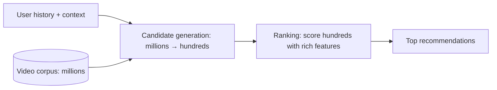

## The problem

YouTube has an enormous and constantly growing catalog, with new videos uploaded every minute, and needs to recommend relevant videos to each user in a fraction of a second. Running a sophisticated model over every video for every request is impossible.

The 2016 paper *Deep Neural Networks for YouTube Recommendations*, by Paul Covington, Jay Adams and Emre Sargin, describes how YouTube structured the problem as two stages.

## The design

### Stage 1: candidate generation

A neural network learns **embeddings**, vectors that represent users and videos, from the user's watch history, search history and demographics, such that videos a user is likely to watch end up near the user's vector. At serving time, finding candidates becomes a **nearest-neighbour search** over video embeddings, returning a few hundred videos out of millions very quickly. See [vector search](/principles/vector-search).

This stage favours **recall and speed**: it needs to include good candidates, not order them perfectly.

### Stage 2: ranking

A second, more expensive network scores each of the few hundred candidates using many more features: details of the video, how the user has interacted with similar content, how recently they watched the channel, and so on.

A key decision: the ranking model predicts **expected watch time** rather than click probability. Optimizing for clicks rewards misleading thumbnails ("clickbait"); watch time better reflects whether users actually valued the recommendation.

## Why the shape matters beyond YouTube

The same **retrieve-then-rank** structure appears throughout large-scale systems:

- **Search engines:** a fast index lookup, then a learned ranker.
- **RAG:** vector and keyword retrieval for candidates, then a reranker selects what goes into the model's prompt. See [retrieval-augmented generation](/principles/rag-architecture).
- **Ads and feeds:** candidate sources, then ranking with business rules.

Splitting the work lets each stage use a different budget: cheap and broad first, expensive and precise last.

## What to take away

<Callout type="tip" title="Key takeaways">
- **Cascade cheap and expensive models.** Narrow millions to hundreds quickly, then spend compute where it matters.
- **Embeddings turn relevance into geometry,** so candidate retrieval becomes nearest-neighbour search.
- **Optimize for what users value,** not the easiest metric: watch time instead of clicks.
- **Retrieval sets the ceiling.** If a good item isn't among the candidates, the ranker can never show it.
</Callout>
