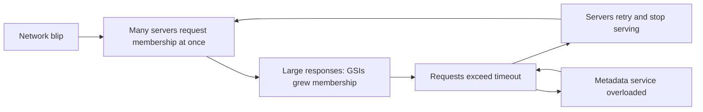

## What happened

DynamoDB splits each table into partitions, and each storage server hosts a set of partitions. Which partitions a server holds is its **membership**, and it lives in an internal **metadata service**. Storage servers periodically fetch their membership to confirm they're still serving the right data. If a server can't get its membership in time, it stops serving requests, a safety measure that prevents it from serving data it no longer owns.

Early on Sunday, September 20, a brief network disruption affected some storage servers. When the network recovered, those servers all asked the metadata service for their membership at the same moment.

## Root cause

Normally this would be routine. But a recent change had made membership responses much bigger: **Global Secondary Indexes** (GSIs), a newer DynamoDB feature, added many more partitions per server. Some membership lookups now took longer than the time limit storage servers allowed.

Servers that timed out **removed themselves from service and retried**. The retries added still more load to the metadata service, so even more requests timed out, in a self-reinforcing loop. Error rates for DynamoDB customers rose sharply from 2:13 AM PDT.

To break the loop, engineers had to **pause requests to the metadata service** so they could add capacity to it, which itself meant more storage servers couldn't confirm their membership for a while. Once capacity was increased and the request flow brought back gradually, DynamoDB recovered by 7:10 AM PDT.

## What changed

- Significantly increased the metadata service's capacity.
- Changed how storage servers time out and retry, so a slow response doesn't turn into a retry storm.
- Reduced the rate at which servers request membership, and worked on changes so membership data is smaller and lookups are cheaper.
- Segmented the metadata service so a problem affects only part of the fleet.

## Lessons

<Callout type="tip" title="Key takeaways">
- **Retries turn slowness into overload.** Fixed timeouts plus immediate retries can amplify a small blip into a full outage. Use exponential backoff with jitter and a retry budget.
- **Synchronized clients are dangerous.** Thousands of servers recovering at the same instant behave like an attack. Add jitter to recovery and refresh timers.
- **Watch for slowly growing costs.** A feature that made responses larger quietly used up the safety margin on a timeout.
- **Fail static where possible.** A server that stops serving because it can't reconfirm its state makes the outage bigger; consider continuing with last-known-good data for a while. See [static stability](/principles/static-stability).
</Callout>
