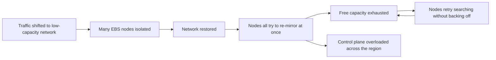

## What happened

Amazon EBS provides network-attached block storage for EC2. Each volume is replicated across EBS nodes in a cluster, and when a node loses its replica partner, it immediately finds a new node with free space and **re-mirrors** its data, so data is never left with a single copy for long.

At 12:47 AM PDT on April 21, during a routine network change in one us-east-1 availability zone, traffic was meant to move to a redundant router on the primary network. Instead, it was **mistakenly shifted to the lower-capacity secondary network**, which couldn't handle it. Many EBS nodes lost contact with their replicas.

## The storm

When the network change was rolled back, the disconnected nodes all came back at once, all believed their data had lost its replica, and **all started searching for free space to re-mirror**.

- The cluster quickly ran out of free space, so many nodes couldn't find a new partner.
- Nodes that failed to find space **retried aggressively without backing off**, keeping the cluster saturated.
- A race condition in the EBS node code, triggered far more often under this load, caused nodes to fail, adding to the number of volumes needing re-mirroring.
- The EBS control plane, shared across availability zones in the region, became overloaded by requests from the affected zone, briefly degrading EBS API calls in other zones too.

## Recovery

AWS first disabled creating new volumes in the affected zone to protect the control plane, then throttled communication from the degraded cluster so other zones recovered. The zone itself needed **more physical capacity**: AWS brought in new servers to give stuck volumes room to re-mirror, then recovered volumes gradually over the following days. A small percentage of volumes couldn't be restored to a consistent state.

## What changed

- Changed EBS nodes to back off more aggressively when they can't find space, and to avoid re-mirroring storms.
- Kept more spare capacity in each cluster to absorb large re-mirroring events.
- Isolated the EBS control plane per availability zone so a problem in one zone can't affect others.
- Improved the network change process and automation to prevent the faulty traffic shift.
- Made it easier for customers to run across multiple availability zones and improved communication during events.

## Lessons

<Callout type="tip" title="Key takeaways">
- **Recovery mechanisms can become the attack.** Automatic re-mirroring is a great feature for one node; thousands doing it at once is a storm. Rate-limit recovery work.
- **Back off when resources are exhausted.** Retrying a search for space that doesn't exist only adds load.
- **Keep headroom.** Spare capacity is what lets self-healing systems actually heal.
- **Zones should not share a control plane.** A regional dependency let one zone's trouble spill into others.
</Callout>
