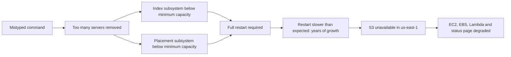

## What happened

At 9:37 AM PST, an S3 engineer was debugging an issue that was making the S3 billing system slow. Following an established playbook, they ran a command meant to remove a small number of servers from one of the subsystems the billing process used.

One input to the command was entered incorrectly, and a much larger set of servers was removed. Some of those servers supported two other critical subsystems:

- **The index subsystem**, which manages the metadata and location of every S3 object in the region. Every GET, LIST, PUT and DELETE needs it.
- **The placement subsystem**, which allocates storage for new objects. It depends on the index subsystem to work.

With too little capacity left, both subsystems had to be fully restarted, and S3 couldn't serve requests until they were back.

## Why recovery took hours

S3 is designed so that losing servers is routine, but these subsystems **hadn't been fully restarted in the larger regions for many years.** In that time S3 had grown enormously, and the restart, including safety checks to validate metadata integrity, took far longer than anyone expected.

The index subsystem was serving GET, LIST and DELETE requests again by 12:26 PM and fully recovered at 1:18 PM. The placement subsystem, which had to wait for the index, recovered at 1:54 PM, at which point S3 was operating normally.

## The dependency nobody was watching

Many other AWS services store data in S3, so the outage spread: new EC2 instance launches, EBS volumes restored from snapshots and Lambda were all affected.

Even the **AWS Service Health Dashboard couldn't be updated**, because its administration console depended on S3. For the first part of the outage the dashboard showed services as healthy while the internet was visibly broken, and AWS posted updates on Twitter instead.

## What AWS changed

- **Safer tooling:** the capacity-removal tool was changed to remove capacity more slowly, and to refuse to take any subsystem below its minimum required capacity. Other operational tools were audited for the same gap.
- **Smaller blast radius:** work to split the index subsystem into smaller partitions, which AWS calls **cells**, was reprioritized so a failure affects a fraction of the region instead of all of it.
- **Faster recovery:** the restart path itself became a focus, since recovery time had grown silently with scale.
- **An independent status page:** the Service Health Dashboard was changed to run across multiple regions.

## Lessons

<Callout type="tip" title="Key takeaways">
- **Tools should make the dangerous thing hard.** A command that can delete a region's worth of capacity in one keystroke needs guard rails, rate limits and a minimum-capacity floor.
- **Untested recovery paths decay.** If a process hasn't run in years, assume it's broken or slow. Exercise restarts regularly.
- **Limit blast radius by design.** Cells turn "the whole region is down" into "a slice of customers is affected".
- **Your status page can't depend on the thing it reports on.** Monitoring and communication tools need to survive the failures they describe.
</Callout>
