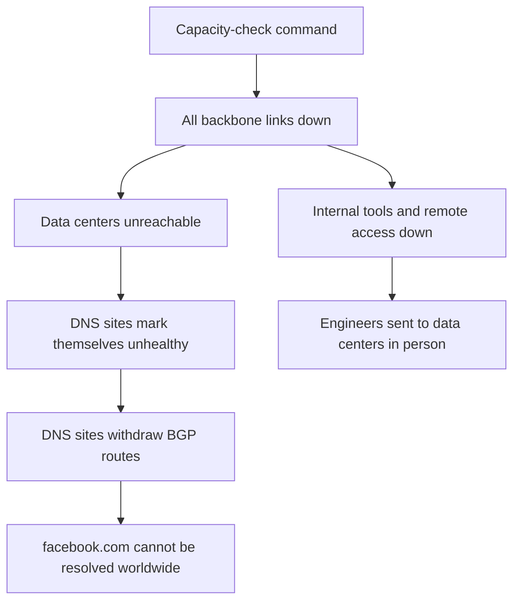

## What happened

Facebook's data centers are connected by a private global backbone network. During routine maintenance, an engineer ran a command intended to **assess the available capacity** of that backbone. Instead, the command took down **all** backbone connections, disconnecting every Facebook data center from every other one and from the internet.

Facebook's systems are designed to audit commands like this and block mistakes. A **bug in the audit tool** let the command through.

## Why everything else went down with it

Facebook runs its own authoritative DNS servers at smaller edge facilities. Those servers are designed to **withdraw their BGP route announcements** if they can't reach Facebook's data centers, on the reasoning that an unhealthy location shouldn't receive traffic.

With the backbone gone, *every* DNS location decided it was unhealthy and withdrew itself at the same moment. The DNS servers were still running, but the rest of the internet could no longer find them. Resolvers worldwide could not look up `facebook.com`, and apps started retrying aggressively, adding load to DNS resolvers everywhere.

## Why recovery took hours

The same outage took out the tools engineers would normally use to diagnose and fix it. Remote access and out-of-band management depended on the network that was down. Engineers had to travel to data centers, and the physical and system security designed to make those facilities hard to tamper with also made them slow to get into and to change.

Once the backbone was restored, Facebook brought traffic back gradually. Flipping everything on at once risked a surge in power demand and a spike of load as caches refilled, so services were restored in stages.

## Lessons

<Callout type="tip" title="Key takeaways">
- **Sensible local rules can combine into a global failure.** "Withdraw if unhealthy" is right for one site, and catastrophic when every site decides it at once. Guard automatic self-removal with a floor ("never withdraw the last N locations").
- **Recovery paths must not depend on the thing that failed.** Out-of-band access, emergency tooling and communication need independent networks and credentials.
- **Safety tooling needs testing too.** The audit tool was the last line of defence, and it had a bug.
- **Practice the restart.** Facebook said it had drilled for failures like this, which helped the gradual bring-up go smoothly; the gap was a scenario where the whole backbone was down at once.
</Callout>
