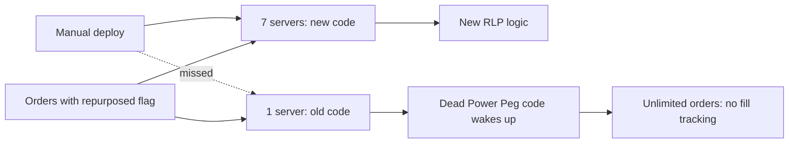

## What happened

Knight Capital was one of the largest US equity traders. Its order router, SMARS, ran on eight servers. To support a new NYSE program (the Retail Liquidity Program), Knight deployed new code to SMARS in the days before August 1, 2012.

The deployment was done manually, and a technician **copied the new code to only seven of the eight servers**. No second person reviewed the deployment, and nothing checked that all servers were running the same version.

## Root cause

The new code **reused an old flag** that had once activated a feature called **"Power Peg"**, which Knight had stopped using in 2003. The Power Peg code had never been removed from SMARS.

When the market opened on August 1, orders carrying the repurposed flag reached all eight servers. On the seven updated servers, the flag meant the new retail-liquidity logic, as intended. On the **eighth server**, it activated the long-dead Power Peg code.

Worse, years earlier Knight had moved the part of Power Peg that tracked how many shares had been filled, so the old code **no longer knew when to stop**. It kept sending child orders into the market as fast as it could.

## Why it ran for 45 minutes

- Knight's systems sent 97 automated emails before the market opened warning of a "Power Peg disabled" error, but they weren't treated as alerts that needed action.
- There was no **kill switch** or automated limit on positions that would stop the router when its behaviour was clearly abnormal.
- While trying to diagnose the problem, engineers **removed the new code from the seven correct servers**, which made all eight servers run the faulty path and made things worse.

By the time trading was stopped, Knight had accumulated billions of dollars in unwanted positions. Unwinding them cost more than $460 million. The SEC later fined Knight $12 million for inadequate controls over market access.

## Lessons

<Callout type="tip" title="Key takeaways">
- **Automate and verify deployments.** Every server should be confirmed to run the intended version; a partial deploy is a silent, mixed fleet.
- **Delete dead code.** Unused code paths can be reactivated by accident years later.
- **Never repurpose a flag.** Retire old flags and create new ones; a flag's meaning should never change.
- **Build kill switches and limits.** Systems that can do damage quickly need automatic circuit breakers on their output, not just on their inputs.
- **Rollback isn't always safe.** In a mixed-version state, "undo the last change" can make things worse. Understand the state before acting.
</Callout>
