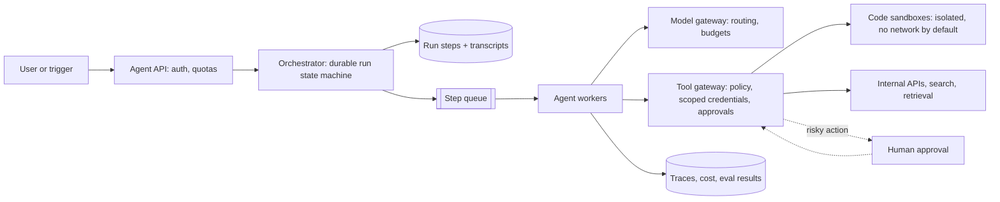

## The problem

Your company wants an internal platform where teams build agents: "triage this support ticket and draft a reply", "investigate why this deploy failed", "fill in this spreadsheet from our CRM". Each agent calls an LLM in a loop, uses tools, and may run for seconds or hours. Design the platform.

## Requirements

**Functional**

- Define agents with a model, instructions and a set of tools (APIs, code execution, web search, retrieval).
- Run tasks asynchronously, stream progress, and let users approve risky actions.
- Keep full transcripts of every run.

**Non-functional**

- Tasks can take hours and must survive worker restarts.
- Agents act with the **user's** permissions, never more.
- Untrusted content (web pages, emails, documents) must not be able to hijack an agent into harmful actions.
- Thousands of concurrent runs; costs tracked per team.

<Reveal title="Hint 1: How do you run a task that takes three hours?">

Don't keep it in one process's memory. Model each run as a **durable state machine**: every LLM call and tool call is a step whose input and result are persisted before moving on. A worker crash means another worker resumes from the last completed step. Workflow engines (Temporal-style durable execution) or a step log in a database plus a [queue](/principles/message-queues-vs-logs) both work.

</Reveal>

<Reveal title="Hint 2: How do you stop an agent doing something harmful?">

Layer defenses. Tools run with **scoped, short-lived credentials** derived from the user's identity ([authorization](/principles/authentication-and-authorization)); the model never sees raw secrets ([secrets management](/principles/secrets-and-config-management)). Code runs in isolated sandboxes with no network by default. Actions are classified by risk: reads run freely, writes with side effects (sending email, merging code, spending money) require human approval. Treat all tool output as untrusted data, because prompt injection can't be fully prevented by the prompt alone.

</Reveal>

<Reveal title="Hint 3: How do you know agents are working?">

Trace every step: prompts, tool calls, results, tokens, latency and cost ([observability](/principles/observability)). Build **evals** per agent: a set of tasks with graders (exact checks where possible, LLM judges with rubrics otherwise) that runs on every change to prompts, tools or models. Watch production signals like task success, human approval rates and escalations. See [evals and guardrails](/principles/llm-evals-and-guardrails).

</Reveal>

## A reference design

- **Orchestrator:** each run is a sequence of persisted steps (call model, call tool, wait for approval). Steps are retried on failure; tool calls carry an [idempotency](/principles/idempotency) key so a retried "create ticket" doesn't create two.
- **Model gateway:** one place for provider keys, routing between models, retries, rate limits and per-team budgets.
- **Tool gateway:** enforces which tools an agent may call, mints short-lived credentials scoped to the requesting user, logs every call, and pauses runs for approval on risky actions.
- **Sandboxes:** ephemeral microVMs or containers per run for code execution, with CPU, memory and time limits and egress allowlists.
- **Context management:** long runs exceed the model's context window, so summarize older steps and keep large tool outputs in storage, passing references. See [agent systems](/principles/agent-systems).

## Deep dives and trade-offs

- **Autonomy vs control:** more approval gates mean safer agents but slower, more annoying ones. Make policy configurable per tool and per team, and start strict.
- **Cost control:** loops can spin; cap steps, tokens and wall-clock time per run, and alert on runaway spend.
- **Multi-agent setups:** an orchestrator agent delegating to specialist sub-agents can help with large tasks, but adds cost and makes failures harder to trace. Start with one agent and good tools.
- **Determinism:** LLM output varies run to run; record everything so a run can be inspected and replayed against new prompts in evals.
- **Tenant isolation:** one team's runaway agent mustn't consume everyone's model quota; queue and quota per team.

## What interviewers look for

<Callout type="interview">
Durable, step-by-step execution that survives crashes; a tool gateway with least-privilege, user-scoped credentials and human approval for risky actions; sandboxed code execution; treating tool output as untrusted; full tracing; and an eval loop that gates changes to prompts, tools and models.
</Callout>
