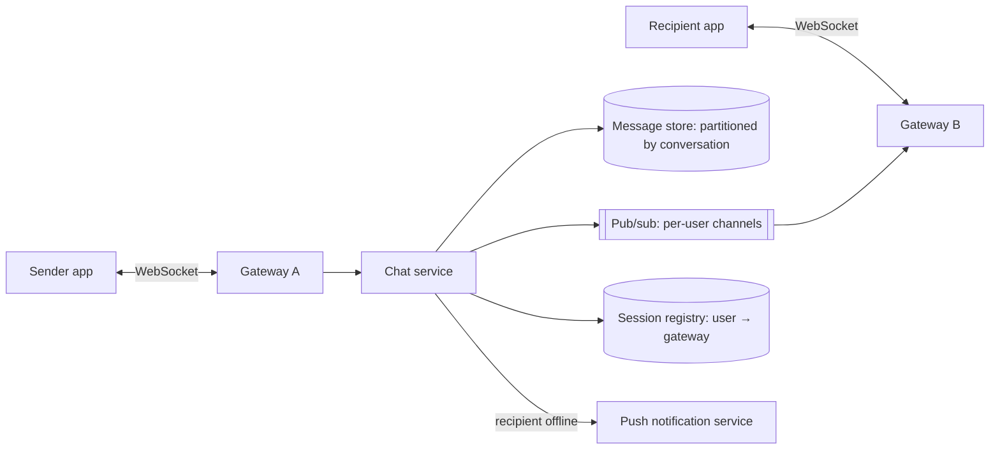

## The problem

Design a chat service supporting one-to-one and group conversations (up to ~500 members), message history, delivery receipts, online presence and push notifications for offline users.

## Requirements

**Functional**

- Send and receive messages in real time.
- Persistent history; scroll back through old messages.
- Delivery and read receipts; online/last-seen presence.
- Push notifications when the recipient is offline.
- Multiple devices per user, kept in sync.

**Non-functional**

- Delivery latency under ~200 ms when both users are online.
- Messages must **never be lost** and should appear in a consistent order within a conversation.
- Scale: 500M daily active users, ~50 billion messages per day.

## Estimate the scale

- 50B messages/day ÷ 10⁵ s ≈ **500,000 messages/s** average, perhaps 1.5M/s at peak.
- Concurrent connections: if 20% of DAU are online at once, **100 million** open connections. At ~1 million connections per server (see [WhatsApp](/case-studies/whatsapp-erlang)), that's on the order of 100+ connection servers, plus headroom.
- Storage: 50B × ~200 bytes ≈ **10 TB per day** before replication.

<Reveal title="Hint 1: How do messages reach the recipient in real time?">

Clients keep a persistent connection (WebSocket or a long-lived TCP/MQTT connection) to a **gateway** server. The gateway servers are stateful (they hold connections), so you need a way to find which gateway a given user is connected to: a session registry, or pub/sub channels per user.

</Reveal>

<Reveal title="Hint 2: How do you store messages?">

The main query is "the latest N messages in this conversation". Partition by conversation ID and order by a time-sortable message ID, much like Discord's `(channel_id, bucket)` key in a wide-column store. See [data modeling](/principles/data-modeling-and-denormalization).

</Reveal>

<Reveal title="Hint 3: How do you keep order and avoid duplicates?">

Let the server assign a per-conversation sequence number (or a time-ordered ID from a single owner per conversation) rather than trusting client clocks. Clients send a client-generated message ID so retries are [idempotent](/principles/idempotency) and don't create duplicates.

</Reveal>

## A reference design

1. Sender's app sends the message (with a client message ID) over its WebSocket to gateway A.
2. The **chat service** validates it, assigns a sequence number for the conversation, and writes it to the **message store**. Only after the write succeeds does it acknowledge the sender ("sent").
3. It publishes the message to the recipients' channels ([pub/sub](/principles/pub-sub)). Gateways subscribed for those users push it down the open connections ("delivered" receipts flow back the same way).
4. Recipients with no live connection get a **push notification**; when they reconnect, the app asks for everything after its last seen sequence number in each conversation.

- **Gateways** are stateful but disposable: if one dies, clients reconnect to another (via the [load balancer](/principles/load-balancing)) and catch up from the store.
- **Chat service** is [stateless](/principles/stateless-services) and scales horizontally.
- **Group messages:** for groups up to ~500, fan out to each member's channel on write. Very large channels would switch to clients pulling from the channel.
- **Presence:** gateways send heartbeats; store last-seen in a fast in-memory store with TTLs, and publish changes only to contacts who are online, possibly throttled.

## Deep dives and trade-offs

- **Ordering:** a single sequencer per conversation gives a total order but makes that conversation's owner a hotspot; that's acceptable because individual conversations are small.
- **Multi-device sync:** each device tracks its own last-read sequence; the server stores per-device or per-user cursors.
- **End-to-end encryption:** the server stores and routes encrypted blobs it can't read; key management lives on clients. Search and moderation become client-side problems.
- **Hot shards:** partition the message store by conversation, and bucket large conversations by time so partitions stay bounded.
- **Backpressure:** if a recipient's gateway is slow, queue per connection with limits rather than blocking the chat service.

## What interviewers look for

<Callout type="interview">
Persistent connections with a way to route to the right gateway; durable write before acknowledging; per-conversation ordering and idempotent sends; offline delivery via push plus catch-up sync; and a storage model partitioned by conversation.
</Callout>
