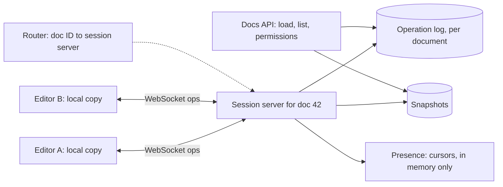

## The problem

Several people open the same document. Each one types, deletes and formats text, and everyone sees the others' cursors and edits within a fraction of a second. People may go offline and keep editing. The document must never diverge or lose work.

## Requirements

**Functional**

- Real-time concurrent editing with live cursors and presence.
- Edit offline and sync on reconnect.
- Version history: see and restore past versions.

**Non-functional**

- Local edits appear instantly; remote edits within ~100–200 ms.
- All clients **converge** to the same document.
- Up to ~100 simultaneous editors per document; millions of documents.

<Reveal title="Hint 1: Why not just send the whole document, last write wins?">

Two people typing at once would overwrite each other's work. Instead, send small **operations** ("insert 'x' at position 10") and merge them. The problem: if Alice inserts at position 10 while Bob deletes position 3, Alice's position is wrong by the time it reaches Bob. Two families of algorithms fix this.

</Reveal>

<Reveal title="Hint 2: Operational transform vs CRDTs?">

**Operational transform (OT)** transforms each incoming operation against concurrent ones (shift Alice's insert left by one because of Bob's delete). It usually relies on a central server to order operations; Google Docs works this way. **CRDTs** give every character a unique, ordered ID, so inserts and deletes commute and any order of applying them converges, even peer to peer and offline. Libraries like Yjs and Automerge implement them. Figma uses a server-ordered, simpler property-level model; see [Figma's multiplayer](/case-studies/figma-multiplayer).

</Reveal>

<Reveal title="Hint 3: Where does a document live while people edit it?">

Route every editor of a document to the **same server process** (a session server), which holds the document in memory, orders incoming operations, broadcasts them, and periodically persists. Use consistent routing by document ID so all connections land in one place; if the server dies, clients reconnect and the document reloads from storage.

</Reveal>

## A reference design

- **Clients** apply their own edits immediately (optimistic local state) and send operations to the session server with a client ID and sequence number.
- **Session server** (one per active document) orders operations, transforms or merges them, broadcasts to other editors, and appends them to a per-document **operation log**. This is [event sourcing](/principles/event-sourcing): the log is the history, and snapshots every few hundred operations make loading fast.
- **Routing:** a router maps document IDs to session servers; everything else (API, auth) is [stateless](/principles/stateless-services).
- **Presence:** cursors and selections go through the same connection but aren't persisted; losing them is harmless.
- **Version history** falls out of the log: named versions are pointers into it.

## Deep dives and trade-offs

- **OT vs CRDT:** OT keeps the data small but needs a central sequencer and careful algorithms; CRDTs work offline and peer to peer but carry per-character metadata and tombstones that need compaction. Both deliver convergence, a form of eventual [consistency](/principles/consistency-models).
- **Ordering:** don't rely on wall clocks to order edits; use server sequence numbers or logical clocks. See [clocks and ordering](/principles/clocks-and-ordering).
- **Offline:** the client buffers operations locally and replays them on reconnect; CRDTs merge them automatically, OT transforms them against everything that happened meanwhile.
- **Permissions:** check edit rights on connect and on every operation; a viewer's client must not be able to inject operations.
- **Large documents and many viewers:** fan out to read-only viewers through [pub/sub](/principles/pub-sub) rather than the session server directly.

## What interviewers look for

<Callout type="interview">
Operations instead of whole-document writes; a clear explanation of OT vs CRDTs and why either converges; one session server per active document with consistent routing; an operation log with snapshots for durability and history; optimistic local edits; and handling for offline edits and reconnection.
</Callout>
