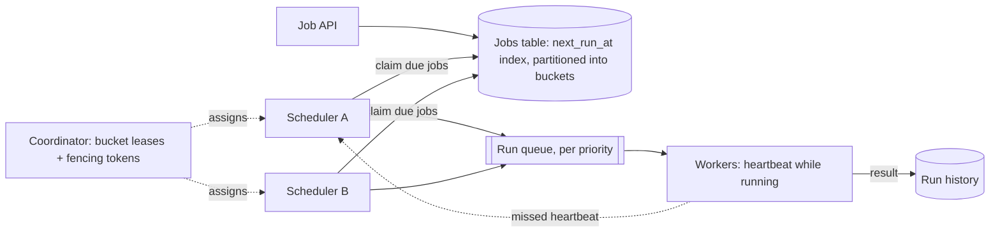

## The problem

Teams register jobs like "every day at 02:00 UTC, run the invoice export" or "in 30 minutes, send the abandoned-cart email for cart 981". Build a service that triggers each job at the right time and runs it on a worker, reporting success, failure and retries.

## Requirements

**Functional**

- Recurring (cron expression) and one-off delayed jobs.
- Retries with backoff, timeouts, and a history of runs.
- Pause, cancel and manually trigger jobs.

**Non-functional**

- 100M scheduled one-off jobs pending; 10,000 jobs firing per second at peak (big spikes on the hour).
- Jobs start within a few seconds of their scheduled time.
- A job is never silently lost; running it twice should be rare and handled.

<Reveal title="Hint 1: How do you find the jobs that are due?">

Store jobs with a `next_run_at` time, indexed by it, and poll "jobs due in the next few seconds". Polling one huge table from many schedulers causes contention, so **partition jobs into buckets** (by job ID hash) and give each scheduler ownership of some buckets. For very high rates, use time-bucketed queues or a hierarchical timing wheel in memory for the near future.

</Reveal>

<Reveal title="Hint 2: How do you stop two schedulers firing the same job?">

Each bucket has exactly one owner at a time, assigned through a coordination service or a lease in the database (see [leader election](/principles/leader-election)). Leases expire, so a paused or partitioned scheduler might still think it owns a bucket; protect state changes with a **fencing token** (an increasing lease number checked on write). See [split-brain and fencing](/principles/split-brain-and-fencing).

</Reveal>

<Reveal title="Hint 3: What does 'exactly once' mean here?">

You can't guarantee a job runs exactly once when workers can crash mid-run. Aim for **at-least-once execution with idempotent jobs**: each run gets a unique run ID that jobs use to dedupe side effects, and a worker heartbeats while running so the scheduler can reassign the run if it dies. See [exactly-once delivery](/principles/exactly-once-delivery).

</Reveal>

## A reference design

1. The **API** writes the job with its next fire time, assigned to a bucket by hashing its ID.
2. Each **scheduler** holds leases on some buckets. Every second it claims jobs in its buckets that are due, marks them `enqueued` with its fencing token, computes the next run time for recurring jobs, and pushes run messages to the **run queue**.
3. **Workers** take runs, execute them with a timeout, heartbeat while running, and write the result. A run whose heartbeats stop is retried after a delay.
4. If a scheduler dies, the coordinator detects the missing heartbeat (see [failure detection](/principles/failure-detection-and-heartbeats)) and reassigns its buckets.

## Deep dives and trade-offs

- **The top-of-the-hour spike:** everyone schedules at `0 * * * *`. Encourage or apply jitter, and scale workers ahead of known peaks. Separate queues by tenant or priority so one team's 100,000 jobs don't delay another's.
- **Clock skew:** schedulers compare against their own clocks; keep them synchronized and accept that "on time" means within a second or two.
- **Missed runs:** if the system was down at 02:00, should the job run late or skip? Make it a per-job policy.
- **Long-running jobs:** a job that runs for hours should checkpoint progress so a retry resumes instead of restarting.
- **Database as queue:** fine up to a point with `SELECT ... FOR UPDATE SKIP LOCKED`; beyond that, move near-term jobs into a dedicated [queue](/principles/message-queues-vs-logs).

## What interviewers look for

<Callout type="interview">
Efficient "what's due" queries via partitioned buckets and a time index; single ownership of each bucket through leases with fencing; separation of scheduling from execution through a queue; at-least-once runs with heartbeats, retries and idempotent jobs; and handling of thundering-herd schedules, missed runs and tenant isolation.
</Callout>
