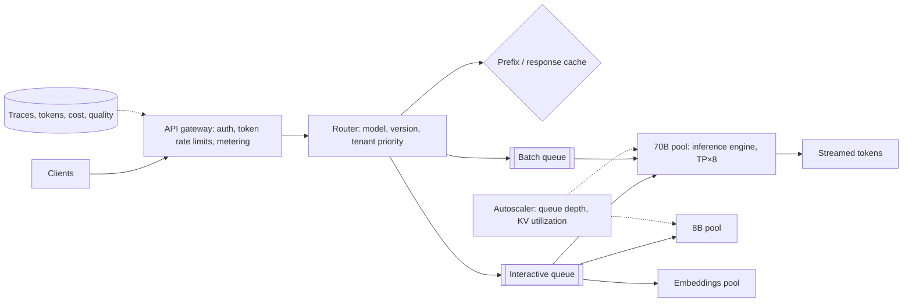

## The problem

Your company wants a platform that serves a few open-weight models (say an 8B, a 70B and an embeddings model) behind one streaming API, used by internal products and paying customers. Design it.

## Requirements

**Functional**

- Chat/completions API with **streaming** responses; embeddings API.
- Multiple models and versions; optional per-customer fine-tuned adapters.
- Usage metering and billing by tokens.

**Non-functional**

- Interactive traffic: time to first token under ~1 s and steady streaming (e.g. 30+ tokens/s per user) at p95.
- Batch traffic (summarizing documents overnight) should use spare capacity cheaply.
- Tenants must be isolated: one customer's spike can't starve others.
- GPUs are the dominant cost; keep utilization high.

## Estimate the scale

- Peak 2,000 interactive requests/s, average prompt 1,500 tokens, output 300 tokens.
- Output tokens: 2,000 × 300 = **600,000 tokens/s** at peak.
- If one 8-GPU node serving the 70B model sustains on the order of a few thousand output tokens/s with good batching, you need **hundreds of GPUs** for the 70B model alone at peak, which is why batching efficiency, routing to smaller models and caching matter so much. (Benchmark your own hardware; numbers vary widely by model, precision and engine.)

<Reveal title="Hint 1: What limits how many requests a GPU can serve?">

Decode is memory-bandwidth-bound and benefits hugely from batching, but batch size is limited by **KV cache memory**: every active sequence holds its own cache. Paged KV memory and continuous batching are the main levers. See [KV cache and PagedAttention](/principles/kv-cache-and-paged-attention) and [continuous batching](/principles/continuous-batching).

</Reveal>

<Reveal title="Hint 2: How do you keep tenants fair?">

Limit by **tokens**, not just requests: tokens per minute and concurrent sequences per tenant. Use separate queues by priority (interactive above batch) and admission control when KV memory is full.

</Reveal>

<Reveal title="Hint 3: How do you autoscale GPUs?">

CPU is meaningless here. Scale on queue depth, active sequences or KV cache utilization. GPU nodes and model weights take minutes to come up, so keep warm capacity and load weights from local disk or a fast cache.

</Reveal>

## A reference design

- **Gateway:** authentication, per-tenant token-based [rate limits](/principles/rate-limiting), usage metering for billing, request validation (max context, max output). See [API gateways](/principles/api-gateways).
- **Router:** picks the model pool from the request, applies priority (interactive vs batch), and can route simple requests to the 8B model ([model routing](/principles/semantic-caching-and-model-routing)).
- **Model pools:** each runs an inference engine (vLLM, TensorRT-LLM, SGLang) with continuous batching and paged KV cache; the 70B model is split across 8 GPUs with tensor parallelism. Fine-tuned customers get **LoRA adapters** on shared base models.
- **Prefix caching:** reuse KV cache for shared system prompts; route requests with the same prefix to the same replica where possible.
- **Streaming:** server-sent events or WebSockets from the pool back through the gateway; handle client disconnects by cancelling generation to free the GPU.
- **Scheduling:** interactive queue first; batch jobs fill spare capacity and are preempted under pressure. See [GPU scheduling](/principles/gpu-scheduling-and-multi-tenancy).
- **Observability:** per-request traces with TTFT, tokens/s, queue time, tokens in/out, cost per tenant; SLO alerts on TTFT and errors. See [observability](/principles/observability).

## Deep dives and trade-offs

- **Prefill vs decode interference:** long prompts stall streaming for everyone on a replica. Use chunked prefill, or disaggregate prefill and decode into separate pools at large scale.
- **Model rollouts:** deploy new versions as separate pools, shift traffic gradually, and compare quality with evals before cutting over.
- **Quantization:** serving the 70B model in FP8 can roughly halve memory per replica; verify quality on your evals first.
- **Failure handling:** a GPU failure kills in-flight streams on that replica; clients retry with idempotent request IDs, and health checks remove bad nodes quickly.
- **Cost controls:** per-tenant budgets, max-tokens defaults, and caching of repeated requests.

## What interviewers look for

<Callout type="interview">
Token-based capacity math; batching and KV memory as the core constraints; queues with priorities and per-tenant token limits; autoscaling on queue depth with warm capacity; streaming with cancellation; and observability of TTFT, throughput and cost.
</Callout>
