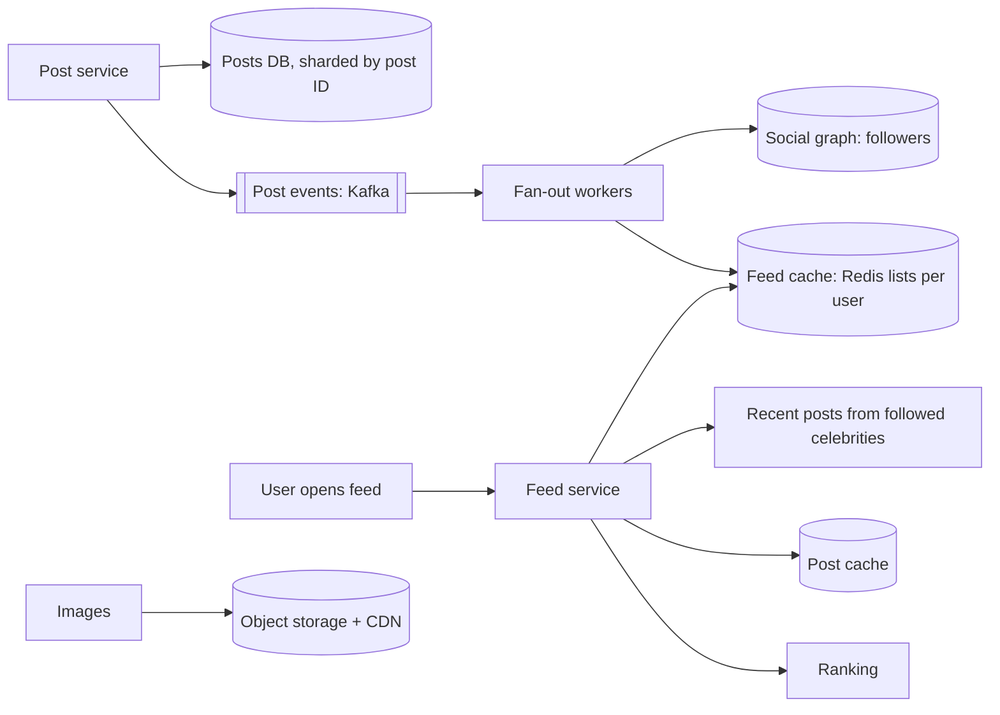

## The problem

Design the home feed for a social network: users follow other users, and their feed shows recent posts from followed accounts, newest first (or ranked). Users can post text and images.

## Requirements

**Functional**

- Post text and images.
- Follow and unfollow users.
- View a home feed of posts from followed accounts, with infinite scroll.

**Non-functional**

- Feed loads in under ~200 ms (p99).
- 300M daily active users; each opens the feed ~10 times a day.
- New posts appear in followers' feeds within a few seconds (eventual consistency is fine).
- Some accounts have tens of millions of followers.

## Estimate the scale

- Feed reads: 300M × 10 ÷ 10⁵ s ≈ **30,000/s** average, ~100,000/s at peak.
- Posts: if 10% of users post once a day, 30M ÷ 10⁵ ≈ **300 posts/s**.
- Average follower count ~200, so fan-out on write is about 300 × 200 = **60,000 feed inserts/s**, manageable for most accounts but extreme for celebrities.

<Reveal title="Hint 1: Fan-out on write or on read?">

**Fan-out on read** (pull): when a user opens the feed, fetch recent posts from everyone they follow and merge. Simple writes, expensive reads.

**Fan-out on write** (push): when someone posts, insert the post ID into each follower's precomputed feed. Reads become one lookup, but writes multiply by follower count.

Reads outnumber writes by 100×, which favours push, except for accounts with huge followings.

</Reveal>

<Reveal title="Hint 2: What about celebrities?">

Use a **hybrid**: push posts from normal accounts into followers' feeds; for accounts above a follower threshold, skip the fan-out and merge their recent posts into the feed at read time. Most users follow only a few such accounts, so the read-time merge is cheap. See [How Twitter built home timelines](/case-studies/twitter-timelines).

</Reveal>

<Reveal title="Hint 3: Where do feeds live?">

Store each user's feed as a bounded list of post IDs (say the latest 500–800) in an in-memory store like Redis, only for active users. Hydrate IDs into full posts from a post cache. Rebuild feeds on demand for users who haven't logged in recently.

</Reveal>

## A reference design

- **Posting:** the post service stores the post, uploads images to [object storage](/principles/object-storage) behind a CDN, and publishes a `PostCreated` event to a [log](/principles/message-queues-vs-logs).
- **Fan-out workers** consume events, look up followers (skipping celebrity authors) and push the post ID onto each active follower's feed list. This is a [CQRS](/principles/cqrs)-style read model.
- **Reading:** the feed service reads the user's feed list, merges recent posts from any celebrities they follow, hydrates posts from a [cache](/principles/multi-tier-caching), optionally ranks them, and returns a page with a [cursor](/principles/pagination).
- **Storage:** posts [sharded](/principles/sharding-and-partitioning) by post ID or author; the social graph sharded by user.

## Deep dives and trade-offs

- **Unfollow and deletion:** remove entries lazily (filter at read time) or with a cleanup job; deleted posts are filtered during hydration.
- **Ranking:** chronological is simple; ranked feeds add a candidate-generation and scoring step, like the [two-stage recommender](/case-studies/youtube-deep-recommendations).
- **Inactive users:** don't waste fan-out on users who haven't logged in for weeks; rebuild their feed on next visit.
- **Consistency:** a user should see their own new post immediately; insert it into their own feed synchronously, or merge it in on read.

## What interviewers look for

<Callout type="interview">
A clear push vs pull decision justified by the read/write ratio, a hybrid for high-follower accounts, bounded cached feeds of IDs with hydration, async fan-out through a queue, cursor pagination, and read-your-own-posts handling.
</Callout>
