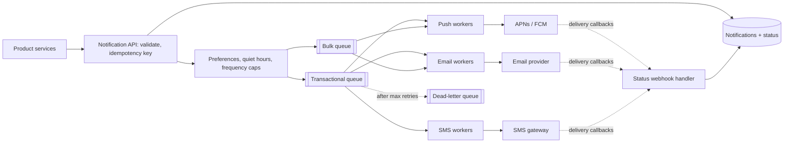

## The problem

Product teams want one service they can call to say "notify user 42 that their order shipped". The platform decides which channels to use (push, email, SMS, in-app), respects the user's preferences and quiet hours, and delivers through providers such as APNs, FCM, an email provider and an SMS gateway.

## Requirements

**Functional**

- Send to one user (transactional) or to millions (marketing campaigns).
- Templates with per-locale content; per-user channel preferences and opt-outs.
- Delivery status tracking (sent, delivered, opened) and an in-app inbox.

**Non-functional**

- Transactional notifications (password reset, 2FA codes) delivered within seconds.
- No duplicates, and no lost transactional messages.
- A campaign to 50M users must not delay a password reset.
- Survive a provider outage.

<Reveal title="Hint 1: Why not call the providers directly from the API?">

Providers are slow, rate-limited and sometimes down. Accept the request, persist it, put it on a **queue**, and return immediately. Workers per channel pull from queues and call providers with timeouts and retries. If the calling service creates the request in the same transaction as its own state change, use the [transactional outbox](/principles/transactional-outbox) so "order shipped" and "notify" can't disagree.

</Reveal>

<Reveal title="Hint 2: How do you keep campaigns from starving urgent messages?">

Separate queues and worker pools by priority: transactional, normal, bulk. That's a [bulkhead](/principles/bulkheads). Bulk sends are throttled to the provider's rate limit and can be paused; transactional queues always have reserved capacity.

</Reveal>

<Reveal title="Hint 3: How do you avoid sending twice?">

Callers pass an **idempotency key** (e.g. `order-123-shipped`). The service records it before enqueueing and ignores repeats. Workers also dedupe on a notification ID before calling the provider, because a worker can crash after sending but before acknowledging the queue message. Exactly-once delivery to a phone isn't possible; you make duplicates rare and harmless. See [idempotency](/principles/idempotency).

</Reveal>

## A reference design

- **API** validates, dedupes by idempotency key, renders nothing yet, and stores the request.
- **Routing** applies user preferences, opt-outs, quiet hours (delay non-urgent messages until morning in the user's time zone) and frequency caps ("no more than 3 marketing pushes a day").
- **Workers** per channel render the template, call the provider with [timeouts and exponential backoff](/principles/timeouts-retries-and-backoff), and wrap each provider in a [circuit breaker](/principles/circuit-breakers) so a failing provider fails fast. Some channels have a fallback (SMS if push fails for a 2FA code).
- **Status** comes back via provider webhooks; failed messages go to a dead-letter queue for inspection.
- **Device tokens** are cleaned up when providers report them as invalid.

## Deep dives and trade-offs

- **Campaign fan-out:** don't enqueue 50M messages at once. A campaign job pages through the audience and enqueues at the rate the providers allow, so it can pause and resume.
- **Rate limits both ways:** you [rate-limit](/principles/rate-limiting) callers so one team's bug can't spam users, and you respect each provider's sending limits.
- **Ordering:** usually doesn't matter, except for things like "order shipped" arriving after "order delivered". Include a timestamp or sequence and let the client drop stale ones.
- **Queue vs log:** a work queue fits per-message retries and acknowledgements; see [message queues vs logs](/principles/message-queues-vs-logs).

## What interviewers look for

<Callout type="interview">
Asynchronous delivery through queues; priority isolation so bulk never blocks urgent messages; idempotency keys and worker-side dedupe; retries with backoff, circuit breakers and dead-letter queues for provider failures; and respect for user preferences, quiet hours and frequency caps.
</Callout>
