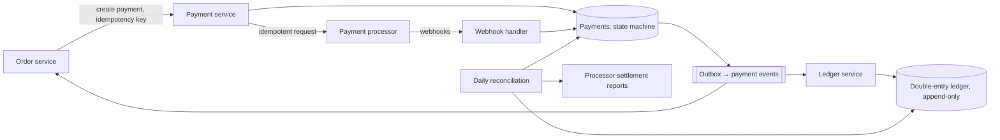

## The problem

An e-commerce company needs a payment service: when a customer checks out, charge their card through a processor (like Stripe or Adyen), record the money movement, update the order, and later pay out sellers. Refunds and disputes must work too.

## Requirements

**Functional**

- Authorize and capture card payments for orders; refunds.
- An internal ledger of every money movement, per customer, seller and the company.
- Daily payouts to sellers.

**Non-functional**

- **Never charge a customer twice for one order, and never lose a payment.**
- Every balance must be explainable from its history (auditable).
- ~1,000 payments per second at peak; correctness matters far more than latency.

<Reveal title="Hint 1: The processor call timed out. Did the charge happen?">

You don't know. Retrying blindly risks a double charge; not retrying risks an order that was paid but never fulfilled. Send an **idempotency key** with each processor request (derived from your payment attempt ID) so a retry returns the original result instead of charging again. See [Stripe's idempotency keys](/case-studies/stripe-idempotency-keys) and [idempotency](/principles/idempotency).

</Reveal>

<Reveal title="Hint 2: How do you record money correctly?">

Use a **double-entry ledger**: every movement is a transaction of entries that sum to zero (debit the customer's account 50, credit the merchant-receivable account 50). Entries are append-only; mistakes are fixed with new reversing entries, never edits. Balances are sums of entries, so they're always explainable. This is close to [event sourcing](/principles/event-sourcing).

</Reveal>

<Reveal title="Hint 3: How do you keep your records and the processor's in agreement?">

They will drift: webhooks get lost, requests time out, people refund in the processor's dashboard. Run **reconciliation**: regularly compare your payment records and ledger against the processor's settlement reports, and flag every mismatch for automated or manual repair.

</Reveal>

## A reference design

- **Payment state machine:** `created → authorizing → authorized → captured → refunded` (plus `failed`). Each transition is a single database [transaction](/principles/transactions-and-isolation-levels) that checks the current state, so duplicate or out-of-order webhooks can't move a payment backwards.
- **Idempotency at every hop:** the order service passes a key to the payment service; the payment service passes a key to the processor; webhook handlers dedupe on the processor's event ID.
- **Unknown outcomes:** on a timeout, mark the payment `unknown` and retry with the same key, or query the processor for its status. Never create a new attempt for the same order while one is unresolved.
- **Events:** state changes and the outgoing event are written together using the [transactional outbox](/principles/transactional-outbox), so the ledger and order service always hear about them.
- **Checkout as a saga:** reserve inventory, charge, confirm order; if a later step fails, compensate (refund, release inventory). See [sagas](/principles/distributed-transactions-and-sagas).

## Deep dives and trade-offs

- **Authorize vs capture:** authorize at checkout, capture when the item ships; authorizations expire, so track them.
- **Retries:** retry only errors the processor marks as safe to retry, with [backoff](/principles/timeouts-retries-and-backoff); a declined card is a final answer, not a transient failure.
- **Money types:** store amounts as integers in minor units (cents) with a currency code; never floats.
- **Payouts:** batch per seller daily from the ledger balance; a payout is itself an idempotent, reconciled operation.
- **Exactly once:** there's no exactly-once network call; you get exactly-once *effects* through idempotency plus reconciliation. See [exactly-once delivery](/principles/exactly-once-delivery).
- **Security and compliance:** let the processor's hosted fields or SDK handle card numbers so your systems never store them, which keeps most of your stack out of PCI DSS scope.

## What interviewers look for

<Callout type="interview">
Idempotency keys end to end, with a clear answer for "the call timed out"; a payment state machine with guarded transitions; an append-only double-entry ledger; outbox-driven events; reconciliation against the processor; and integer money in minor units.
</Callout>
