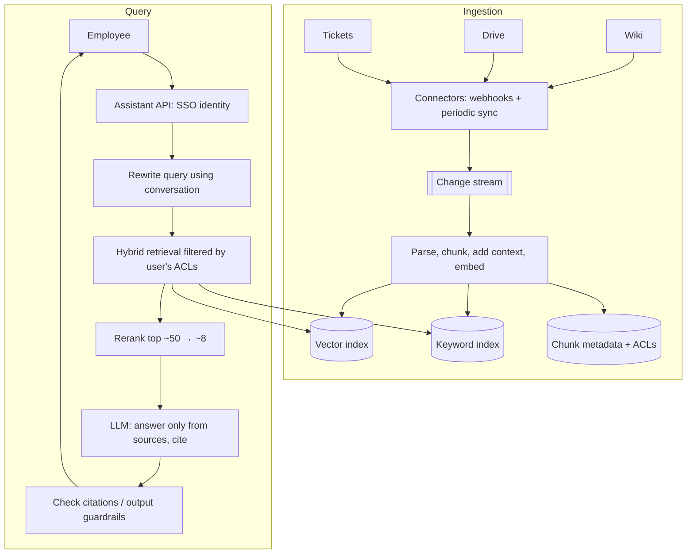

## The problem

Employees ask questions like "what's our parental leave policy in Germany?" or "how do I rotate the payments service's database credentials?". Build an assistant that answers from internal sources (wiki, Google Drive, Slack, ticketing system, code docs) with citations.

## Requirements

**Functional**

- Natural-language questions in a chat interface, with follow-up questions.
- Answers grounded in internal documents, with **citations** linking to sources.
- Says "I don't know" when sources don't contain the answer.

**Non-functional**

- **Never reveal content a user isn't allowed to see.**
- Changes to source documents are reflected within minutes.
- Answer starts streaming within ~2 seconds.
- 20,000 employees; ~10 million document chunks.

<Reveal title="Hint 1: How do you split and index documents?">

Chunk documents along their structure (headings, paragraphs) into a few hundred tokens each, add context (document title, section path) to each chunk, embed them, and index them both in a vector index and a keyword (BM25) index. Store metadata with each chunk: source, URL, last modified, and **access control lists**. See [RAG architecture](/principles/rag-architecture).

</Reveal>

<Reveal title="Hint 2: How do you enforce permissions?">

Filter at **retrieval time**: every chunk carries the groups/users allowed to read its source document, and the query filters on the asking user's identity and groups. Never retrieve first and filter later in the prompt; the model must not see content the user can't. Keep ACLs in sync when sharing settings change.

</Reveal>

<Reveal title="Hint 3: How do you know it's working?">

Build an eval set of real questions with known answers and sources. Measure **retrieval recall** (were the right chunks in the top results?) separately from **answer quality** (correct, faithful to sources, cited). Run it on every change to chunking, embeddings, prompts or models. See [evals and guardrails](/principles/llm-evals-and-guardrails).

</Reveal>

## A reference design

- **Ingestion:** connectors receive change webhooks (or poll) from each source, feeding a change stream. Workers parse, chunk, contextualize, embed and upsert chunks; deletions and permission changes update or remove chunks. This is [stream processing](/principles/stream-processing) and, at heart, [cache invalidation](/principles/cache-invalidation).
- **Retrieval:** [hybrid search](/principles/vector-search) (vector + keyword) with metadata filters for the user's permissions, then a reranker picks the best chunks.
- **Generation:** a prompt instructs the model to answer only from provided sources, cite them by ID, and say when it can't find an answer. Stream the response.
- **Identity:** users sign in with company SSO; their group memberships drive retrieval filters. See [authentication and authorization](/principles/authentication-and-authorization).
- **Caching and routing:** cache embeddings of frequent queries; route simple lookups to a smaller model ([routing](/principles/semantic-caching-and-model-routing)). Avoid caching answers across users with different permissions.

## Deep dives and trade-offs

- **Prompt injection:** documents can contain instructions ("ignore previous instructions and..."). Treat retrieved text as data, don't give the assistant tools with side effects without approval, and filter outputs.
- **Freshness vs cost:** re-embedding changed documents is cheap; re-embedding everything when you change the embedding model is expensive, so plan for it.
- **Long or tabular documents:** spreadsheets and PDFs need specialized parsing; tables often work better summarized or queried directly.
- **Conversation context:** follow-ups like "what about France?" need query rewriting using the chat history.
- **Feedback loop:** thumbs up/down and "this was wrong" reports feed the eval set.

## What interviewers look for

<Callout type="interview">
A clear ingestion pipeline with incremental updates and deletions; permissions enforced at retrieval time; hybrid retrieval plus reranking; grounded, cited answers that can say "I don't know"; and an evaluation plan that measures retrieval and answers separately.
</Callout>
