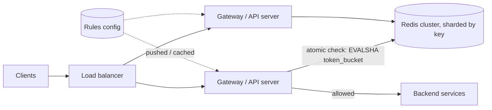

## The problem

Your public API runs on 50 servers behind a load balancer. Design a rate limiter that enforces rules like "100 requests per second per API key" and "10 requests per minute per IP on the login endpoint", consistently across all servers.

## Requirements

**Functional**

- Limits per API key, user, IP and endpoint, configurable without deploys.
- Reject over-limit requests with **HTTP 429** and a `Retry-After` header.
- Allow short bursts while enforcing an average rate.

**Non-functional**

- Adds at most ~1–2 ms of latency per request.
- Handles ~500,000 requests per second across the fleet.
- If the limiter itself fails, the API should keep working.

<Reveal title="Hint 1: Which algorithm?">

Compare fixed window, sliding window log, sliding window counter and token bucket. Token bucket allows bursts up to the bucket size while enforcing a refill rate, and needs only two numbers per key (tokens, last refill time). Sliding window counter is a good alternative that avoids fixed-window boundary bursts. See [rate limiting](/principles/rate-limiting).

</Reveal>

<Reveal title="Hint 2: Where does the state live?">

Each server only sees a fraction of a client's traffic, so counters must be shared, typically in Redis. Updates must be **atomic**: a read-modify-write from two servers at once will undercount. Use a Lua script or atomic increments with expiry.

</Reveal>

<Reveal title="Hint 3: What if Redis is slow or down?">

The rate limiter shouldn't take down the API. Use a short timeout on the Redis call, and **fail open** (allow the request) with a conservative local, per-server limit as a backstop. Shard keys across Redis nodes with consistent hashing so one node's failure only affects some keys.

</Reveal>

## A reference design

- **Placement:** run the check in the [API gateway](/principles/api-gateways) (or middleware) before any expensive work.
- **Algorithm:** token bucket per `(rule, key)`. A Lua script reads tokens and timestamp, refills based on elapsed time, decrements if possible and writes back, all atomically in Redis.
- **Keys:** `rl:{rule_id}:{api_key}` with a TTL so idle keys expire.
- **Rules:** stored in a config service, cached in each gateway and refreshed periodically, so changes don't need deploys.
- **Response:** 429 with `Retry-After` and headers showing the limit and remaining quota.

## Deep dives and trade-offs

- **Latency:** one Redis round trip (~0.5 ms in-region). For very high volume, batch locally: each server takes a small allowance of tokens at once and spends them locally, syncing periodically. Less exact, much cheaper.
- **Accuracy vs cost:** exact global limits need a central check per request; approximate limits (local counters synced every 100 ms) tolerate small overshoot.
- **Multi-region:** enforce limits per region with a share of the global quota, or accept eventual consistency between regions.
- **Hot keys:** one abusive key hammering one Redis shard; local pre-filtering of keys already known to be over limit protects Redis.
- **Rate limits aren't overload protection:** every client can be within its limit while total load exceeds capacity; pair this with [load shedding](/principles/backpressure-and-load-shedding).

## What interviewers look for

<Callout type="interview">
A justified algorithm choice, atomic shared counters, a clear plan for the limiter failing (fail open with local fallback), low added latency, and the distinction between per-client fairness and protecting the system from total overload.
</Callout>
