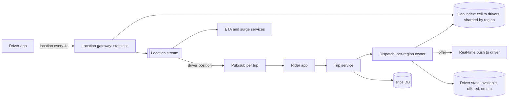

## The problem

A rider requests a trip. Within a few seconds, the system should offer it to a nearby available driver, track the driver's approach in real time, and handle the trip through to payment.

## Requirements

**Functional**

- Drivers report location while online; riders see nearby cars.
- Request a ride, get matched with a driver, see their live location and ETA.
- Trip lifecycle: requested, accepted, arriving, in progress, completed.

**Non-functional**

- Match within ~5 seconds; location shown to the rider within a couple of seconds of reality.
- 5M drivers online at peak, each sending a location every 4 seconds.
- A driver must never be assigned two trips at once.

## Estimate the scale

- Location updates: 5M ÷ 4 s = **1.25M writes/s**. Most are overwritten seconds later, so this is a stream, not a database workload.
- Ride requests: perhaps 1,000–10,000/s, tiny by comparison.

<Reveal title="Hint 1: How do you find drivers near a point quickly?">

Divide the map into cells: **geohash** strings, Google's S2 cells, or Uber's hexagonal **H3** grid. Each driver's location maps to a cell ID; an in-memory index maps cell → drivers in it. "Nearby" means the rider's cell plus its neighbors, expanding rings until there are enough candidates. Hexagons are handy because all six neighbors are the same distance away.

</Reveal>

<Reveal title="Hint 2: Where do 1.25M location writes per second go?">

Not into a relational database. Updates go to a stateless ingestion tier, then to an in-memory geospatial index **sharded by region or cell**, overwriting the previous position. A copy flows into a [stream](/principles/stream-processing) for ETAs, surge pricing and analytics; only trip routes are stored durably.

</Reveal>

<Reveal title="Hint 3: How do you avoid double-assigning a driver?">

Matching for one area should go through a single owner (a dispatch shard for that region), and the assignment itself is an atomic compare-and-set on the driver's state: `available → offered` with an expiry. If the driver declines or the offer times out, the state returns to available and the next candidate is tried.

</Reveal>

## A reference design

- **Location ingestion:** [stateless](/principles/stateless-services) gateways accept updates over persistent connections and write the latest position into the geo index, partitioned by city or cell range so each shard is small enough to stay in memory. See [sharding](/principles/sharding-and-partitioning).
- **Dispatch:** for a request, query the rider's cell and neighbors, rank candidates by ETA (road distance, not straight-line), and offer the trip to the best driver with an atomic state change. Large systems batch requests for a second or two and solve the matching for many riders at once, which beats greedy one-by-one matching.
- **Trip service:** owns the trip state machine in a durable database; trip events drive notifications, payments and receipts.
- **Live tracking:** during a trip, the driver's updates are published on a per-trip channel ([pub/sub](/principles/pub-sub)) the rider's app subscribes to.

## Deep dives and trade-offs

- **Hot cells:** an airport or stadium after a concert concentrates load in a few cells; split hot regions finer or replicate their index.
- **Consistency:** the geo index is eventually consistent and a few seconds stale, which is fine for "nearby"; the assignment must be strongly consistent. Knowing which data needs which [consistency model](/principles/consistency-models) is the core trade-off.
- **Regional isolation:** cities are natural [cells](/principles/cell-based-architecture); an outage in one region's dispatch shouldn't affect others.
- **Mobile networks:** location updates arrive late and out of order; keep only updates newer than the stored timestamp.

## What interviewers look for

<Callout type="interview">
Location-write math that rules out a normal database; a cell-based geospatial index sharded by region; ETA-based ranking rather than straight-line distance; an atomic driver assignment with offer timeouts; and separating eventually consistent location data from strongly consistent trip state.
</Callout>
