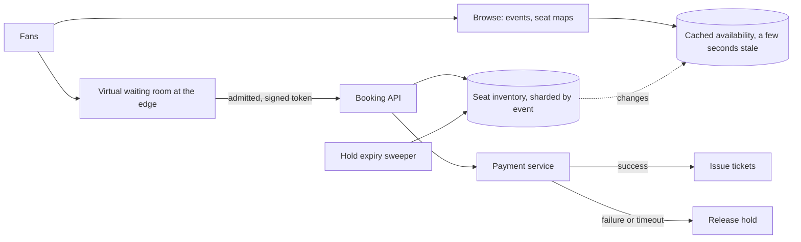

## The problem

Users browse events, pick specific seats on a seat map, hold them while they pay, and receive tickets. For a big artist, millions of people show up at the moment sales open for perhaps 50,000 seats.

## Requirements

**Functional**

- Browse events and see a seat map with availability.
- Select seats and hold them for ~10 minutes while paying.
- Complete purchase; release seats if payment fails or the hold expires.

**Non-functional**

- **No seat is ever sold twice.**
- Survive on-sales with millions of concurrent users and stay fair to them.
- Browsing can be slightly stale; booking must be exact.

<Reveal title="Hint 1: How do you stop two people buying the same seat?">

Make the seat reservation an atomic, conditional update: `UPDATE seats SET status='held', holder=?, hold_expires=? WHERE id=? AND status='available'`. If it updates zero rows, someone else got it. That's optimistic concurrency, and it's enough for a single seat. Holding several seats at once should happen in one [transaction](/principles/transactions-and-isolation-levels) on one partition (shard by event).

</Reveal>

<Reveal title="Hint 2: What happens when 2 million people arrive at once?">

You can't let them all hit the booking database. Put a **virtual waiting room** in front: users join a queue at the edge, get a position, and are let in at the rate the booking system can handle. This is admission control, a form of [load shedding](/principles/backpressure-and-load-shedding), and it's also fairer than whoever refreshes fastest. Add per-user and per-IP [rate limits](/principles/rate-limiting) and bot detection.

</Reveal>

<Reveal title="Hint 3: How do holds expire?">

Store `hold_expires` with the seat. Treat expired holds as available in the reservation query (`... OR hold_expires < now()`), and run a sweeper that cleans them up. Don't depend on the client to release seats.

</Reveal>

## A reference design

- **Browsing:** event pages and seat maps come from a [cache](/principles/caching-strategies) refreshed every few seconds; it can show a seat as available that was just taken, and the booking step is the source of truth.
- **Waiting room:** admits users at a controlled rate and hands them a signed token the booking API requires, so nobody skips the queue.
- **Reservation:** an atomic conditional update holds the seats with an expiry; the response includes the hold ID.
- **Checkout:** a small [saga](/principles/distributed-transactions-and-sagas): hold seats → charge with an [idempotency key](/principles/idempotency) → mark seats sold and issue tickets; on payment failure, release the hold.
- **Inventory** is partitioned by event, so one huge on-sale doesn't slow down other events.

## Deep dives and trade-offs

- **General admission:** without assigned seats, use a counter per section (`remaining = remaining - n WHERE remaining >= n`). A single hot counter can become a bottleneck; split it into several sub-counters if needed.
- **Hot rows:** everyone wants front-row seats. Contention is real but bounded: each seat can only be won once, so most requests fail fast.
- **Bots and scalpers:** purchase limits per account, verified accounts for presale, and queue tokens bound to an account.
- **Fairness vs throughput:** a randomized queue at opening time is fairer than first-come-first-served for people who arrive in the same second.

## What interviewers look for

<Callout type="interview">
An atomic, conditional seat hold with expiry; a clear split between stale-but-cheap browsing and exact booking; a virtual waiting room to admit traffic at a safe rate; idempotent payment with release on failure; and partitioning by event so one on-sale can't take down the rest.
</Callout>
