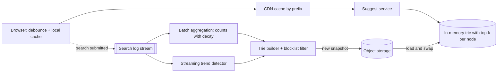

## The problem

As a user types `how to b`, show the 5–10 most popular queries that start with that prefix: "how to boil eggs", "how to buy bitcoin"... Suggestions should reflect what people actually search for and pick up new trends within the hour.

## Requirements

**Functional**

- Return the top 10 completions for a prefix, ranked by popularity.
- Update rankings from recent search logs.
- Filter offensive or blocked suggestions.

**Non-functional**

- Suggestions appear in under ~100 ms end to end, so the server has maybe 10–20 ms.
- 100M daily active users, each doing ~10 searches of ~15 keystrokes.
- Highly available; stale suggestions are fine, missing ones are not.

## Estimate the scale

- Requests: 100M × 10 × 15 ÷ 10⁵ s ≈ **150,000 requests/s** average, perhaps 400,000/s at peak.
- Unique queries worth suggesting: tens of millions. At ~30 bytes each plus counts, the full set fits in **a few GB** of memory, so you can replicate it rather than partition it.

<Reveal title="Hint 1: What data structure answers a prefix query?">

A **trie** (prefix tree) finds all strings with a prefix by walking one node per character. Walking the whole subtree to find the top 10 is too slow for short prefixes like `a`, so **store the precomputed top-k completions on each node**. A lookup then becomes "walk to the prefix node, return its list".

</Reveal>

<Reveal title="Hint 2: Do you update the trie on every search?">

No. Writing on every keystroke would contend with the read path. Log searches, aggregate counts offline (hourly or daily, with a decay so old trends fade), build a new trie, and swap it in atomically. For breaking trends, run a small streaming job that boosts fast-rising queries.

</Reveal>

<Reveal title="Hint 3: How do you cut the request rate?">

Most of the 150k requests/s are for short, popular prefixes with identical answers. Cache responses at the CDN and in the browser for a few minutes, debounce keystrokes on the client (wait ~50–100 ms after typing stops), and have the client fetch a prefix's list once and filter it locally as the user keeps typing.

</Reveal>

## A reference design

- **Serving:** stateless suggest servers each hold the full trie in memory, loaded from a snapshot. Lookups are a walk of a few characters plus returning a stored list, well under a millisecond.
- **Caching:** browser and [CDN caches](/principles/cdn-and-edge-caching) keyed by prefix absorb most traffic; see [multi-tier caching](/principles/multi-tier-caching).
- **Data pipeline:** submitted searches flow into a log. A batch job computes popularity with time decay; a [streaming job](/principles/stream-processing) detects trends. A builder applies the blocklist, computes top-k per node and publishes a versioned snapshot.
- **Rollout:** servers load the new snapshot alongside the old one and swap a pointer, so there is no partial state.

## Deep dives and trade-offs

- **Partitioning:** if the trie outgrows one machine (many languages, personalization), [shard](/principles/sharding-and-partitioning) by prefix range, being careful that ranges like `s` are far hotter than `x`; split by observed load, not alphabet.
- **Personalization:** blend global suggestions with the user's own recent searches on the client, which keeps the server cache-friendly.
- **Freshness vs cost:** hourly rebuilds are cheap; minute-level freshness needs a mutable index and costs much more. Ask what freshness the product actually needs.
- **Safety:** offensive suggestions are a real reputational risk; run the blocklist at build time and keep a fast kill switch for individual phrases.

## What interviewers look for

<Callout type="interview">
Request-rate math that shows why every millisecond and every cache layer matters; a trie with precomputed top-k per node; updates done offline and swapped in atomically rather than written live; aggressive client and CDN caching with debouncing; and a plan for trends and blocked terms.
</Callout>
