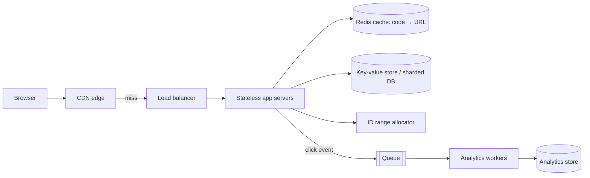

## The problem

Design a service that:

- Takes a long URL and returns a short one, like `https://sho.rt/aZ3kQ9`.
- Redirects anyone who visits the short URL to the original.
- Optionally supports custom aliases, expiry dates and click counts.

Take a few minutes to sketch your own answer before opening the hints.

## Requirements

**Functional**

- Create a short link for a long URL.
- Redirect short link → long URL (HTTP 301 or 302).
- Custom aliases (optional), expiry (optional), basic click analytics.

**Non-functional**

- Redirects must be **fast** (p99 under ~50 ms) and **highly available**; a broken redirect breaks someone else's website.
- Short codes must be **unique** and hard to guess sequentially.
- Reads vastly outnumber writes.

## Estimate the scale

Assume 100 million new links per month and 100 reads per write.

- Writes: 100M ÷ 2.5M seconds ≈ **40/s** (peak ~200/s).
- Reads: **4,000/s** average, perhaps **20,000/s** at peak.
- Storage: ~500 bytes per link × 100M × 12 months × 5 years ≈ **3 TB** (about 9 TB with 3× replication).
- Code length: base62 (a–z, A–Z, 0–9) with 7 characters gives 62⁷ ≈ **3.5 trillion** codes, plenty.

See [back-of-the-envelope estimation](/principles/back-of-the-envelope-estimation).

<Reveal title="Hint 1: How do you generate unique short codes?">

Three common options:

- **Hash the URL** (e.g. first 7 base62 characters of a SHA-256). Simple, but collisions need handling, and the same URL from different users gets the same code.
- **Counter + base62 encoding:** a unique number per link, encoded in base62. Guaranteed unique, but sequential codes are guessable, and a single global counter is a bottleneck.
- **Pre-allocated ID ranges:** each app server reserves a block of IDs (e.g. 1,000 at a time) from a central counter, then encodes them. No per-request coordination. Shuffle or encrypt the number before encoding (a reversible permutation) if guessability matters.

</Reveal>

<Reveal title="Hint 2: What makes the read path fast?">

The read path is a key-value lookup: `code → long URL`. It's read-heavy and mostly immutable, which makes it ideal for caching. Think about a cache in front of the database, and even caching redirects at a CDN edge.

</Reveal>

<Reveal title="Hint 3: 301 or 302?">

A **301 (permanent)** redirect lets browsers and CDNs cache it, which reduces load, but you lose visibility into repeat clicks and can't change the destination later. A **302 (temporary)** sends every click to you, which is better for analytics and expiry. Many shorteners use 302, or 301 with a short cache lifetime.

</Reveal>

## A reference design

- **Create:** the app server takes the next ID from its pre-allocated range, permutes and base62-encodes it, writes `code → URL, owner, expiry` to the database, and returns the short link. Custom aliases use a conditional write ("insert if not exists").
- **Redirect:** check the cache, then the database on a miss ([cache-aside](/principles/caching-strategies)), and return a 302. Popular links stay hot in cache; the CDN can cache redirects briefly.
- **Storage:** a key-value store (DynamoDB, Cassandra) or a relational database with the code as primary key; [shard](/principles/sharding-and-partitioning) by code if one node isn't enough. See [SQL vs NoSQL](/principles/sql-vs-nosql).
- **Analytics:** emit click events to a queue asynchronously so counting never slows redirects.
- **Abuse:** [rate-limit](/principles/rate-limiting) link creation per user/IP, and check new URLs against malware and phishing lists.

## Deep dives and trade-offs

- **Hot links:** a viral link gets millions of clicks. The cache and CDN absorb it; make sure a cache miss storm can't hit the database (see [cache stampede](/principles/cache-stampede)).
- **Expiry:** store an expiry time; check it on read, and clean up expired rows with a background job or database TTLs.
- **Availability:** redirects only need reads, so serve them from replicas in several regions; creation can tolerate a little more latency.
- **Deleting or editing links:** invalidate the cache entry (and the CDN entry if cached).

## What interviewers look for

<Callout type="interview">
A quick estimate that shows reads dominate; a clear ID-generation strategy and why; a cached read path; analytics kept off the critical path; and awareness of abuse and hot keys.
</Callout>
