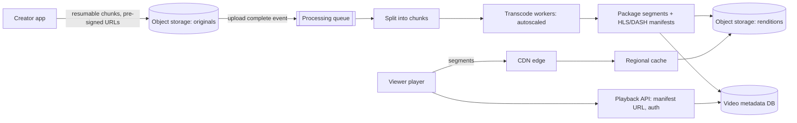

## The problem

Creators upload videos up to several GB. Viewers watch on phones, laptops and TVs with network speeds that change minute to minute. Design upload, processing and playback.

## Requirements

**Functional**

- Upload large video files reliably, even on flaky connections.
- Process each video into formats for every device; generate thumbnails.
- Play back smoothly, adapting quality to the viewer's bandwidth.

**Non-functional**

- 500 hours of video uploaded per minute; videos playable within minutes of upload.
- Playback starts in under ~2 seconds and rarely rebuffers.
- Hundreds of millions of daily viewers worldwide.

## Estimate the scale

- Upload: 500 hours/min ≈ 30,000 minutes of video per minute. Stored at ~5 renditions averaging ~1 GB/hour, that's roughly **2.5 TB of new storage per minute**, a few PB per day.
- Egress dominates everything: 100M viewers × 1 hour × ~2 GB/hour ≈ **200 PB per day**, which only CDNs and edge caches can serve.

<Reveal title="Hint 1: How do you upload a 5 GB file over a phone connection?">

Use **resumable, chunked uploads**: the client asks for an upload session, sends the file in chunks (say 8 MB) that are acknowledged individually, and resumes from the last acknowledged chunk after a drop. Upload straight to [object storage](/principles/object-storage) with pre-signed URLs so your API servers never carry video bytes.

</Reveal>

<Reveal title="Hint 2: What does transcoding produce?">

Each video is encoded into a **ladder** of resolutions and bitrates (240p to 4K), each split into short segments of a few seconds, plus a manifest (HLS or DASH) listing them. The player measures throughput and picks the best rendition for each next segment: **adaptive bitrate streaming**. Splitting the source into chunks lets you transcode them in parallel across many workers.

</Reveal>

<Reveal title="Hint 3: How do you serve 200 PB a day?">

From the edge. Segments are immutable files with long cache lifetimes, ideal for [CDNs](/principles/cdn-and-edge-caching). Popular videos stay hot at the edge; the long tail is fetched from regional caches and origin. Large services go further and place their own cache appliances inside ISPs, as Netflix does with Open Connect.

</Reveal>

## A reference design

- **Upload:** resumable chunked uploads directly to object storage; an "upload complete" event starts processing.
- **Processing pipeline:** a [queue](/principles/message-queues-vs-logs) of tasks (validate, split, transcode each chunk at each rendition, stitch, package, thumbnails, content checks), run on a GPU/CPU fleet that [autoscales](/principles/autoscaling) on queue depth. Make tasks idempotent so failed ones can simply re-run.
- **Metadata:** title, owner, status, available renditions in a database; the video goes live when its core renditions are ready, and 4K can follow later.
- **Playback:** the API checks access and returns a manifest URL (signed for paid content); the player fetches segments from the [CDN](/principles/cdn-and-edge-caching) and switches renditions as bandwidth changes.

## Deep dives and trade-offs

- **Encoding cost vs storage:** encoding every upload in every format wastes compute on videos nobody watches. Encode popular videos with more expensive, more efficient codecs (and per-title encoding), and keep the long tail at a basic ladder.
- **Startup time:** start at a low rendition so the first segment arrives quickly, then step up; preload the first segment for videos likely to be clicked.
- **Cache tiers:** edge, regional and origin form a [multi-tier cache](/principles/multi-tier-caching); prewarm edges before a big premiere.
- **Live streaming** is a different problem: segments are produced in real time and latency targets are seconds, not minutes.

## What interviewers look for

<Callout type="interview">
Separating upload/processing from delivery; resumable uploads straight to object storage; a parallel, idempotent transcoding pipeline driven by a queue; segmented adaptive bitrate streaming; and egress math showing the design is really a CDN problem.
</Callout>
