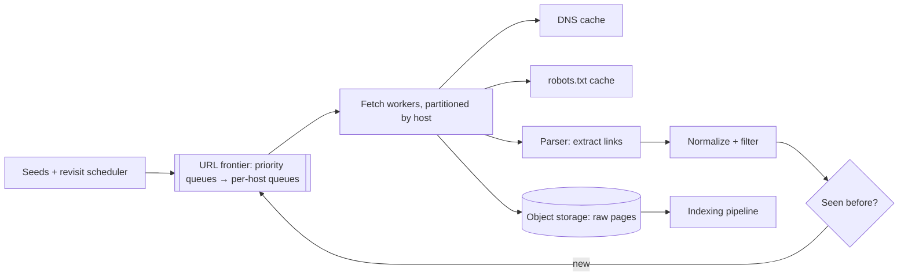

## The problem

Starting from a set of seed URLs, fetch pages, extract their links, and keep going, so that a search engine has a fresh copy of the web to index. Don't overload any website and don't waste effort on duplicates or traps.

## Requirements

**Functional**

- Fetch HTML pages, extract links, and store page content for indexing.
- Respect `robots.txt` and per-site crawl rates.
- Revisit pages on a schedule based on how often they change.

**Non-functional**

- Crawl ~1 billion pages per week.
- Never send more than about one request per second to a single host (unless allowed).
- Scale horizontally; tolerate worker crashes without losing the crawl.

## Estimate the scale

- 1B pages ÷ 604,800 s ≈ **1,650 pages/s**.
- At ~100 KB per page, that's ~165 MB/s of download and **~100 TB per week** of raw HTML (less when compressed).
- At ~1 s per fetch and many fetches in flight per worker, a few dozen to a hundred machines is enough; network and DNS are the bottlenecks, not CPU.

<Reveal title="Hint 1: What is the URL frontier?">

The frontier is the to-do list of URLs. It needs two things: **priority** (important or frequently changing pages first) and **politeness** (one host at a time, with delays). A common design has front queues by priority feeding back queues keyed by host, where each back queue is served by exactly one worker that enforces the delay for that host.

</Reveal>

<Reveal title="Hint 2: How do you avoid fetching duplicates?">

Normalize URLs (lowercase host, strip fragments and tracking parameters) and check a "seen" set before adding to the frontier. With billions of URLs, a **Bloom filter** in memory gives a fast "definitely new" or "probably seen" answer. For content, hash each page body; many URLs serve identical content (mirrors, session IDs), so skip parsing pages whose hash you've stored.

</Reveal>

<Reveal title="Hint 3: How do you spread work across machines?">

Partition by **host**, using [consistent hashing](/principles/consistent-hashing) from hostname to worker. That keeps all of a host's URLs on one worker, so politeness, robots.txt caching and DNS caching are local, and a worker joining or leaving moves only a slice of hosts.

</Reveal>

## A reference design

- **Frontier:** durable queues (a [log or queue](/principles/message-queues-vs-logs)) partitioned by host, with priority on top. Workers pull from their own hosts' queues and wait out each host's crawl delay.
- **Fetchers:** async I/O with thousands of connections per machine; cache DNS and robots.txt per host; obey per-host [rate limits](/principles/rate-limiting).
- **Storage:** raw pages go to [object storage](/principles/object-storage) with the URL, fetch time and content hash; an indexing pipeline reads from there.
- **Dedupe:** a Bloom filter on normalized URLs, plus a content-hash store.
- **Revisits:** track how often each page changed between visits and schedule the next crawl accordingly; news homepages hourly, old blog posts monthly.

## Deep dives and trade-offs

- **Crawler traps:** infinite calendars and endlessly generated URLs. Limit URL length and depth per host, and cap pages per host per crawl cycle.
- **Backpressure:** if parsing or storage falls behind, stop pulling from the frontier rather than buffering in memory; see [backpressure](/principles/backpressure-and-load-shedding).
- **Failure:** a worker crash leaves its in-flight URLs unacknowledged; they return to the queue after a timeout. Fetching a page twice is harmless.
- **JavaScript-heavy sites:** rendering pages in a headless browser costs 10–100× more; do it only for important sites.
- **Bloom filter false positives:** a tiny fraction of new URLs are wrongly skipped; acceptable for a crawler, and you size the filter to keep the rate low.

## What interviewers look for

<Callout type="interview">
Throughput math; a frontier that handles both priority and per-host politeness; host-based partitioning; URL normalization plus Bloom-filter and content-hash dedupe; durable queues so crashes don't lose work; and awareness of traps, robots.txt and revisit scheduling.
</Callout>
