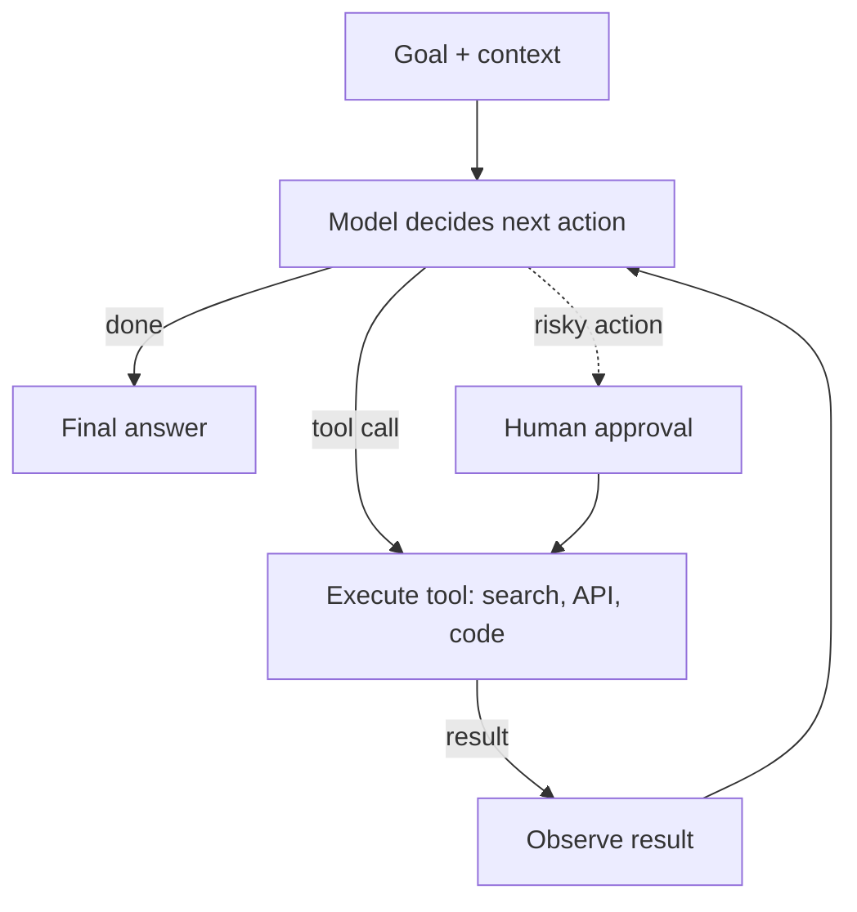

## The problem it solves

A single model call can answer a question, but many tasks need several steps with real-world information: look up an order, check the refund policy, issue a refund, email the customer. Or: read a bug report, search the codebase, edit files, run tests, fix failures. Hard-coding every path is brittle; letting a model decide the steps is flexible, but introduces new failure modes.

## How it works

### Workflows vs agents

Anthropic's *Building effective agents* draws a useful line:

- **Workflows:** LLM calls and tools orchestrated through **predefined code paths** (prompt chaining, routing, parallel calls). Predictable, testable, cheaper.
- **Agents:** the LLM **dynamically decides** which tools to use and when, in a loop, until it judges the task complete. Flexible, but slower, costlier and less predictable.

Its advice: start with the simplest thing that works, often a single well-prompted call or a workflow, and use agents only when the task genuinely needs open-ended decisions.

### The agent loop

The ReAct pattern (reason, act, observe) formalized this: the model alternates between reasoning about what to do and calling tools, using each result to decide the next step.

### Tools

- **Design tools like APIs for a new colleague:** clear names, precise descriptions, simple parameters, helpful error messages. Poor tool design is a leading cause of agent mistakes.
- **Return compact, relevant results;** huge tool outputs fill the context window.
- **Standardize integrations:** the **Model Context Protocol (MCP)** is an open protocol for exposing tools and data sources to models, so one integration works across many agent applications.

### Systems concerns

| Concern | Practice |
|---|---|
| **Runaway loops** | Step limits, token and cost budgets, wall-clock timeouts |
| **Side effects** | [Idempotent](/principles/idempotency) tools; dry-run modes; human approval for irreversible actions (payments, deletions, emails) |
| **Permissions** | Least privilege: the agent acts with scoped credentials, never more than the user it acts for |
| **Untrusted content** | Web pages, emails and documents can contain injected instructions; treat tool output as data, and restrict what actions it can trigger |
| **Execution** | Run code in sandboxes (containers, VMs) with no access to secrets or production by default |
| **State** | Persist progress so long tasks survive crashes and can resume, like a [saga](/principles/distributed-transactions-and-sagas) or workflow |
| **Observability** | Trace every model call, tool call, input and output for debugging and audit |

## Trade-offs

- **Autonomy vs control:** more freedom lets agents handle unexpected situations, and also make unexpected mistakes.
- **Latency and cost:** each loop iteration is a model call; complex tasks can take dozens.
- **Errors compound:** a 95%-reliable step repeated 20 times succeeds far less often overall. Verification steps and checkpoints help.
- **Evaluation is harder** than for single responses; you need task-level success measures on realistic scenarios. See [evals and guardrails](/principles/llm-evals-and-guardrails).

## In the real world

<Callout type="example" title="Simple, composable patterns">
Anthropic's guidance, drawn from working with many teams building agents, is that the most successful implementations use simple, composable patterns rather than complex frameworks. It highlights coding agents as an area where agents work well, because results can be checked automatically by running tests, and recommends investing heavily in clear tool definitions and documentation.
</Callout>

The **Model Context Protocol** was introduced by Anthropic in late 2024 as an open standard and has since been adopted across many AI tools and platforms, playing a role for agent tools similar to what a common driver interface plays for hardware.

## Interview angle

<Callout type="interview">
If asked to design an agent (a support agent, a coding assistant), first ask whether a fixed workflow would do. If an agent is justified, cover the tool interfaces, the loop with step and cost limits, sandboxed execution, scoped credentials, human approval for irreversible actions, durable state, and tracing.
</Callout>

- Giving an agent broad credentials "to make it work".
- No step or cost limits.
- Trusting instructions found in web pages or documents.
