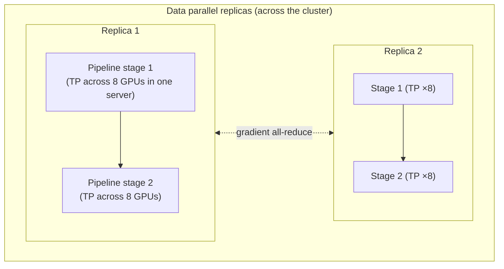

## The problem it solves

Training a frontier model means processing trillions of tokens through a model with hundreds of billions of parameters. One GPU would take centuries, and the model's weights, gradients and optimizer state (often around 16 bytes per parameter with mixed-precision Adam) don't fit in one GPU's memory anyway.

The work has to be split across thousands of GPUs, in a way that keeps them all busy and doesn't drown them in network traffic.

## How it works

### Data parallelism (DP)

Every GPU holds a full copy of the model and processes a different slice of each batch. After each step, GPUs **all-reduce** their gradients so every copy stays identical.

- Simple and scales well, until the model no longer fits on one GPU.
- **ZeRO / FSDP (fully sharded data parallel)** fixes the memory problem by **sharding** optimizer state, gradients and even weights across data-parallel GPUs, gathering each layer's weights only when needed.

### Tensor parallelism (TP)

Split each layer's large matrix multiplications across several GPUs, as in NVIDIA's **Megatron-LM**. Every layer needs communication between those GPUs, so TP is kept **within a server**, where GPUs are connected by very fast links (NVLink).

### Pipeline parallelism (PP)

Assign consecutive layers to different GPUs or servers, like an assembly line. To avoid GPUs sitting idle waiting for the previous stage, each batch is split into **micro-batches** that flow through the pipeline (introduced by Google's **GPipe**). Communication is only between neighbouring stages, so PP works **across servers**.

### Sequence / context parallelism

For very long training sequences, split the sequence itself across GPUs so attention memory fits.

### Putting them together

Large runs combine all of these: tensor parallelism inside each server, pipeline parallelism across a few servers, and data parallelism (often sharded) across everything else.

## Trade-offs

| Strategy | Saves memory? | Communication | Best placed |
|---|---|---|---|
| Data parallel | No (unless sharded) | Gradients once per step | Anywhere |
| FSDP / ZeRO | Yes | More, overlapped with compute | Across servers |
| Tensor parallel | Yes | Every layer, very frequent | Within a server |
| Pipeline parallel | Yes | Between stages only | Across servers; has idle "bubbles" |

- **Network topology matters:** training clusters use high-bandwidth fabrics (InfiniBand or RDMA over Ethernet) and place jobs to match communication patterns.
- **Bigger clusters, more failures:** at thousands of GPUs, something fails every few hours. See [training fault tolerance](/principles/training-fault-tolerance-and-checkpointing).
- **Efficiency is measured as MFU** (model FLOPs utilization), the share of the hardware's theoretical compute actually used; large runs commonly reach somewhere around 40%.

## In the real world

<Callout type="example" title="Llama 3's 4D parallelism">
Meta trained Llama 3 405B on up to **16,384 H100 GPUs**. Its paper describes combining four kinds of parallelism (tensor, context, pipeline and fully sharded data parallelism), arranged so the most communication-heavy dimension stays within a server and the least stays across the whole cluster. Meta reported reaching around 38–43% model FLOPs utilization at that scale. See [How Meta trained Llama 3 on 16,000 GPUs](/case-studies/meta-llama-3-training).
</Callout>

Megatron-LM (NVIDIA) and DeepSpeed's ZeRO (Microsoft) made these techniques widely available, and PyTorch's FSDP brought sharded data parallelism into the standard framework.

## Interview angle

<Callout type="interview">
If asked how to train a model too large for one GPU, explain the layers: shard optimizer state and weights with FSDP/ZeRO; use tensor parallelism within a server where links are fastest; add pipeline parallelism across servers; and data parallelism across the rest. Mention that failures are routine at scale, so checkpointing is part of the design.
</Callout>

- Tensor parallelism across slow network links.
- Ignoring optimizer state when estimating memory.
