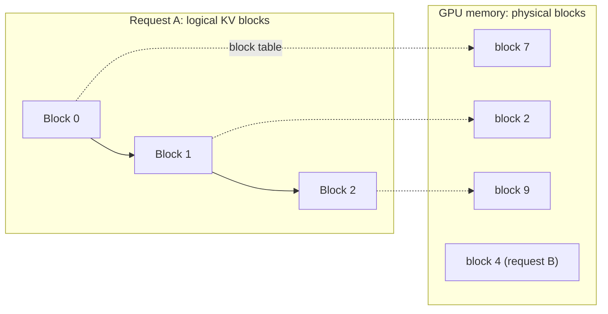

## The problem it solves

During decoding, each new token needs to attend to every previous token in the sequence. Recomputing the attention keys and values for all previous tokens at every step would be enormously wasteful, so servers store them in a **KV cache**. Each new token only computes its own keys and values and appends them.

The catch: the KV cache is **large** (hundreds of kilobytes to megabytes per token for big models) and **grows unpredictably**, since you don't know in advance how long a response will be. Before PagedAttention, serving systems typically reserved one contiguous chunk of GPU memory per request, sized for the **maximum** possible length. Most of that reservation went unused.

## How it works

### KV cache size

```text
KV bytes per token = 2 (K and V) × layers × KV heads × head dimension × bytes per value
```

For a 13B-parameter model this is roughly 800 KB per token in 16-bit precision. Multiply by sequence length and concurrent requests, and the KV cache often uses more GPU memory than the model weights.

### PagedAttention

The vLLM team at UC Berkeley borrowed the idea of **virtual memory paging** from operating systems:

- The KV cache is split into fixed-size **blocks** (e.g. 16 tokens each).
- A request's blocks don't need to be contiguous; a **block table** maps the sequence's logical blocks to physical blocks in GPU memory, like a page table.
- Blocks are allocated **on demand** as the sequence grows, so memory isn't reserved for tokens that may never be generated.
- Only the last block of each sequence can be partly empty, so waste is tiny.



### Sharing and prefix caching

Because blocks are referenced through a table, several sequences can **share** blocks, with copy-on-write when they diverge:

- **Parallel sampling and beam search:** several candidate outputs share the prompt's blocks.
- **Prefix caching:** requests that start with the same long system prompt or document reuse the cached blocks instead of recomputing prefill. Many providers offer discounted "prompt caching" built on this idea.

### Shrinking the cache itself

- **Multi-query and grouped-query attention (MQA/GQA):** many query heads share fewer key/value heads, cutting KV size several-fold. Many recent open models use GQA.
- **KV cache quantization:** store keys and values in 8-bit or lower precision.
- **Offloading:** move inactive sequences' KV blocks to CPU memory or SSD.

## Trade-offs

- **Indirection cost:** attention kernels must follow the block table, which needs custom GPU kernels.
- **Preemption:** when memory runs out, the server must pause some sequences and either swap their blocks to CPU memory or drop and later recompute them.
- **Prefix caching needs identical prefixes:** put stable content (system prompt, tools, documents) first and variable content last to maximize reuse.
- **Smaller KV formats (GQA, quantization)** may slightly affect quality; they're usually chosen at model training time.

## In the real world

<Callout type="example" title="vLLM">
The vLLM paper (SOSP 2023) found that existing serving systems used only about 20–38% of their KV cache memory for actual token data, with the rest lost to over-reservation and fragmentation. With PagedAttention, waste dropped to near zero, which let vLLM batch many more requests and achieve **2–4× higher throughput** than state-of-the-art systems at the same latency. vLLM became one of the most widely used open-source inference engines, and paged KV caches are now standard across serving frameworks. See [vLLM and PagedAttention](/case-studies/vllm-pagedattention).
</Callout>

## Interview angle

<Callout type="interview">
When sizing an LLM deployment, compute the KV cache per token and multiply by context length and concurrency, and compare it with GPU memory left after the weights. Then mention paged KV allocation, prefix caching for shared system prompts, and GQA to fit more concurrent requests.
</Callout>

- Sizing concurrency from weights alone.
- Putting variable content before shared content, which defeats prefix caching.
