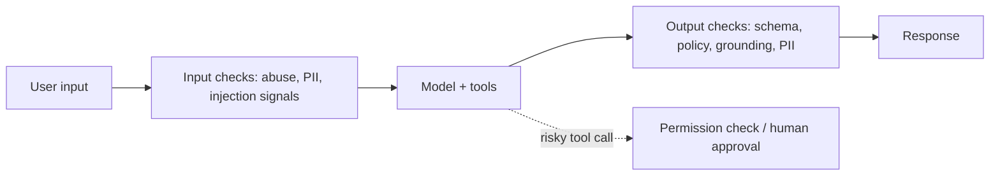

## The problem it solves

Traditional software either works or throws an error. LLM features fail quietly: a confident wrong answer, a missed instruction, a response in the wrong format, a leaked system prompt, or an action taken because a document told the model to. Changing a prompt, a model version or a retrieval setting can improve some cases and silently break others.

Without measurement, teams ship on vibes and find regressions through user complaints.

## How it works

### Evals: tests for probabilistic systems

1. **Build a dataset** of realistic inputs, including hard and adversarial cases, ideally drawn from real (anonymized) traffic. Start small, say 50–200 cases, and grow it from production failures.
2. **Define what "good" means** per task: correctness, faithfulness to sources, format, tone, safety, task completion for agents.
3. **Score automatically:**
   - **Code-based checks** where possible: exact match, JSON schema validation, does the code compile and pass tests, does the answer cite a retrieved document.
   - **LLM-as-judge** for open-ended quality: a strong model grades responses against a rubric or compares two responses.
   - **Human review** for calibration and high-stakes cases.
4. **Run on every change** (prompt, model, retrieval, tools) and compare with the baseline before release, like a CI test suite.

### Observability in production

- **Trace every request:** prompt, retrieved context, model and version, tool calls, output, latency, tokens and cost. See [observability](/principles/observability).
- **Monitor quality signals:** user feedback, regeneration rates, refusal rates, format-error rates, and sampled online evals.
- **Roll out changes gradually,** with A/B comparisons, like any [progressive delivery](/principles/progressive-delivery).

### Guardrails

- **Input:** detect abuse, strip or mask sensitive data, and flag likely prompt-injection attempts.
- **Output:** validate structure (schemas), check policy compliance, check claims against retrieved sources, redact sensitive data.
- **Actions:** the most important guardrails are in ordinary code, outside the model: least-privilege credentials, allow-lists for tools, rate and spend limits, and human approval for irreversible actions.

### Know the main risks

The OWASP Top 10 for LLM applications lists risks including **prompt injection** (direct and through retrieved content), sensitive information disclosure, supply-chain issues, improper output handling, **excessive agency** (giving models more permissions than needed) and unbounded resource consumption.

## Trade-offs

- **LLM judges have biases** (favouring longer answers, or their own style). Calibrate them against human labels and use clear rubrics.
- **Eval sets go stale;** keep adding real failures.
- **Guardrails add latency and false positives;** apply heavier checks where the stakes justify them.
- **No filter stops prompt injection reliably,** so limit what a compromised model could do rather than relying on detection alone.

## In the real world

<Callout type="example" title="LLM-as-a-judge">
The *Judging LLM-as-a-Judge* paper (LMSYS, 2023) introduced MT-Bench and analysed Chatbot Arena's crowdsourced comparisons. It found that strong models like GPT-4 used as judges agreed with human preferences over 80% of the time, about the same as humans agree with each other, while documenting biases such as position and verbosity bias. The approach is now a standard part of LLM evaluation pipelines, alongside human review.
</Callout>

## Interview angle

<Callout type="interview">
For any LLM feature, describe how you'd know it works: an eval set with automated checks and an LLM judge run on every prompt or model change; production tracing with quality and cost dashboards; and guardrails, especially least-privilege permissions and approvals for actions, since prompt injection can't be fully filtered.
</Callout>

- Shipping prompt changes without an eval run.
- Relying on the model to police its own permissions.
