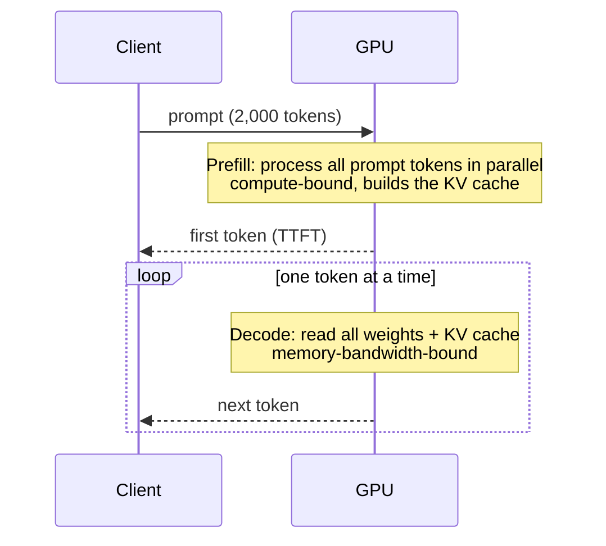

## The problem it solves

Serving an LLM looks like any other API, a request in and a response out, but it behaves very differently from a typical web service. A single request can occupy a GPU for seconds, memory use grows as the response gets longer, and the cost per request is high. Understanding where the time and memory go is the starting point for everything else in AI infrastructure.

## How it works

### Tokens

Models read and write **tokens**, chunks of text averaging roughly three-quarters of an English word. A request has **input tokens** (the prompt, including any system prompt, conversation history and retrieved documents) and **output tokens** (the generated response).

### Two phases

- **Prefill:** the model processes every prompt token in one forward pass. The work is large matrix multiplications, so it's **compute-bound** and uses the GPU efficiently. Its result is the **KV cache**, stored attention keys and values for every prompt token. See [KV cache and PagedAttention](/principles/kv-cache-and-paged-attention).
- **Decode:** the model generates output one token at a time. Each step reads **all the model's weights** from GPU memory to produce a single token per sequence. With little computation per byte read, decode is **memory-bandwidth-bound**: the GPU's compute units mostly wait for memory.

That's why **batching** matters so much for decode: reading the weights once and using them for many sequences at the same step multiplies throughput almost for free. See [continuous batching](/principles/continuous-batching).

### Metrics

| Metric | Meaning | Driven by |
|---|---|---|
| **TTFT** (time to first token) | Delay before the response starts | Prefill time, queueing |
| **TPOT / ITL** (time per output token, inter-token latency) | Speed of streaming | Decode step time, batch size |
| **Throughput** | Tokens per second per GPU across all requests | Batch size, memory |
| **Goodput** | Requests per second that meet latency targets | All of the above |

End-to-end latency ≈ TTFT + (output tokens × TPOT). Long outputs dominate latency; long prompts dominate TTFT.

### Where the memory goes

- **Weights:** parameters × bytes per parameter. A 70-billion-parameter model in 16-bit precision needs about 140 GB, more than one 80 GB GPU, so it's split across several.
- **KV cache:** grows with every token of every active sequence. The vLLM paper notes that for a 13B-parameter model, the KV cache for a **single token** is about 800 KB, so one 2,000-token conversation needs over 1.5 GB.
- **Activations and overhead:** smaller, but not zero.

## Trade-offs

- **Latency vs throughput:** bigger batches raise throughput but slow each user's token rate. Interactive chat and offline batch jobs want different settings.
- **Context length costs memory:** longer contexts mean bigger KV caches, which means fewer concurrent requests per GPU.
- **Model size vs cost:** a larger model may be more capable but needs more GPUs and more memory bandwidth per token. Often a smaller or [quantized](/principles/quantization-and-distillation) model is good enough.
- **Streaming** hides latency from users by showing tokens as they arrive; it doesn't reduce total compute.

## In the real world

<Callout type="example" title="Google: partitioning for latency or throughput">
Google's *Efficiently Scaling Transformer Inference* paper analyzes how to split large models across TPU chips for inference. It shows that the best partitioning depends on the goal: settings optimized for low latency (small batches, fast decode) differ from settings optimized for throughput (large batches), and that memory bandwidth, not raw compute, limits decode. The same reasoning applies to GPU serving.
</Callout>

Providers price input and output tokens separately, often charging several times more per output token, which reflects exactly this asymmetry: prefill processes input tokens in parallel, while each output token needs its own memory-bound decode step.

## Interview angle

<Callout type="interview">
When designing an LLM-backed feature, estimate tokens: "average prompt 1,500 tokens, output 300 tokens, 50 requests per second", then reason about TTFT (prefill of 1,500 tokens) and streaming speed, GPU memory for weights plus KV cache, and how batching sets cost per request.
</Callout>

- Treating LLM calls like cheap, fast API calls.
- Ignoring KV cache memory when estimating concurrency.
