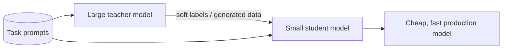

## The problem it solves

A 70-billion-parameter model stored in 16-bit precision needs about 140 GB of GPU memory just for weights, before any KV cache. That means multiple expensive GPUs per replica. And because decoding is memory-bandwidth-bound, every token requires reading all those bytes.

Shrinking the model, in bits per weight or in number of weights, cuts memory, cost and latency.

## How it works

### Quantization: fewer bits per number

| Format | Bytes per weight | 70B model weights | Notes |
|---|---|---|---|
| FP32 | 4 | ~280 GB | Training precision (historically) |
| FP16 / BF16 | 2 | ~140 GB | Standard serving precision |
| FP8 / INT8 | 1 | ~70 GB | Supported natively on recent GPUs; usually small quality loss |
| INT4 | 0.5 | ~35 GB | Fits on a single GPU; needs careful methods |

- **Weight-only quantization** (e.g. INT4 weights, 16-bit activations) mainly speeds up memory-bound decoding, since fewer bytes are read per token.
- **Weight + activation quantization** (e.g. FP8 for both) also speeds up compute-bound prefill on hardware that supports it.
- **Post-training quantization (PTQ)** converts a trained model using a small calibration dataset. **GPTQ** quantizes layer by layer while compensating for the error introduced; **AWQ** protects the small fraction of weights that matter most, based on activation magnitudes.
- **Quantization-aware training** simulates low precision during training for better quality at very low bit widths.
- **KV cache quantization** applies the same idea to the cache, fitting more concurrent requests.

### Distillation: a smaller model that imitates

A large **teacher** model generates outputs (or full probability distributions over tokens), and a smaller **student** model is trained to match them. The student learns from the teacher's "soft" predictions, which carry more information than hard labels alone.

Common uses: a small model specialized for one task (classification, extraction, routing) that runs far cheaper than a general-purpose large model, or smaller general models in a family trained with help from the largest one.

## Trade-offs

- **Quality loss:** usually small at 8 bits, more noticeable at 4 bits and below, and uneven across tasks. Always evaluate on your own workload, not just public benchmarks. See [evals](/principles/llm-evals-and-guardrails).
- **Hardware support:** speed-ups need kernels and hardware that support the format; otherwise you save memory but not time.
- **Distillation costs training time and data,** and the student is only as good as the teacher on the tasks it was trained for.
- **Licensing:** check whether a model's terms allow using its outputs to train other models.

## In the real world

<Callout type="example" title="From BERT to LLMs">
Distillation went mainstream with **DistilBERT** (Hugging Face, 2019), which kept about 97% of BERT's language-understanding performance while being 40% smaller and 60% faster. For LLMs, **GPTQ** showed that models with over 100 billion parameters could be quantized to 3–4 bits in a few GPU hours with little accuracy loss, and methods like **AWQ** made 4-bit models practical to serve on single GPUs. Open-model releases now commonly ship official quantized versions alongside full-precision weights.
</Callout>

## Interview angle

<Callout type="interview">
When cost or GPU count is a constraint, propose serving a quantized model (FP8 or INT4) after checking quality on an eval set, or distilling a small task-specific model for high-volume simple tasks while routing hard requests to a large model.
</Callout>

- Quantizing without evaluating on your own tasks.
- Expecting speed-ups on hardware without support for the format.
