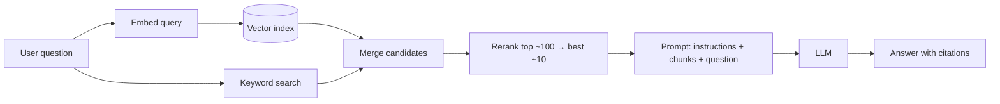

## The problem it solves

A language model only knows what was in its training data. It doesn't know your company's documents, last week's changes or a customer's account details, and when asked anyway, it may produce a confident, wrong answer. Fine-tuning a model on your data is slow, expensive, hard to update and still doesn't reliably teach facts.

RAG keeps knowledge **outside** the model: find the relevant information at question time and give it to the model as context.

## How it works

### Indexing (offline)

1. **Load** documents from their sources (wikis, tickets, PDFs, databases).
2. **Chunk** them into passages, typically a few hundred tokens, often with some overlap and respecting structure (headings, paragraphs, code blocks).
3. **Embed** each chunk with an embedding model, turning it into a vector that captures its meaning.
4. **Store** vectors in a [vector index](/principles/vector-search), alongside the text and metadata (source, date, permissions). Many systems also build a keyword (BM25) index.

### Query time (online)

1. Optionally **rewrite** the query (expand abbreviations, resolve "it" from the conversation).
2. **Retrieve** candidates with vector search and keyword search (**hybrid search**), filtered by metadata such as the user's permissions.
3. **Rerank** candidates with a more accurate (and slower) model that scores each chunk against the question.
4. Put the best chunks in the prompt with instructions to answer **only from the provided sources and cite them**.

### Improving retrieval

- **Chunk with context:** a chunk saying "revenue grew 3%" is useless without knowing which company and quarter. Prepend document titles, section headings or a short generated summary to each chunk before embedding.
- **Hybrid search:** embeddings capture meaning; keywords catch exact terms like error codes, product names and IDs.
- **Reranking** usually gives one of the largest quality gains for little effort.
- **Freshness:** re-index when sources change, and delete chunks when documents are removed. This is [cache invalidation](/principles/cache-invalidation) again.

## Trade-offs

- **Retrieval failures look like model failures:** if the right chunk isn't retrieved, the model can't answer. Measure retrieval separately (did the top 10 contain the answer?).
- **More context isn't always better:** stuffing many chunks raises cost and latency and can distract the model.
- **Permissions must be enforced at retrieval time.** Never let a user's question pull chunks from documents they can't access.
- **RAG vs long context:** models with very large context windows can read whole documents directly; RAG still wins on cost, latency and scale when the corpus is large.
- **Prompt injection:** retrieved documents can contain instructions; treat them as data, not commands. See [evals and guardrails](/principles/llm-evals-and-guardrails).

## In the real world

<Callout type="example" title="Contextual retrieval">
Anthropic's *Contextual Retrieval* post describes adding a short, model-generated explanation of each chunk's context (which document it's from, what it's about) before embedding and keyword-indexing it. In their tests, this reduced failed retrievals by **49%**, and by **67%** when combined with reranking. It also notes that for knowledge bases small enough to fit in the prompt (under roughly 200,000 tokens), including everything with prompt caching can be simpler than building retrieval at all.
</Callout>

The term RAG comes from a 2020 paper by researchers at Facebook AI Research, UCL and NYU, which combined a neural retriever over Wikipedia with a generator model and showed more factual answers on knowledge-intensive tasks.

## Interview angle

<Callout type="interview">
For "build a chatbot over our docs", walk through indexing (chunking with context, embeddings plus BM25, metadata for permissions) and querying (hybrid retrieval, reranking, a grounded prompt with citations). Then cover evaluation (retrieval recall and answer faithfulness), freshness and access control.
</Callout>

- Jumping to fine-tuning for knowledge that changes.
- Ignoring document permissions in retrieval.
- Not measuring retrieval quality separately from answer quality.
