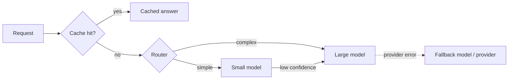

## The problem it solves

A single large-model call can take several seconds and cost far more than a typical database query. Many requests are repeats or near-repeats ("how do I reset my password?"), many share large identical prefixes (the same system prompt and documents), and many are simple enough for a much smaller model. Sending everything to the biggest model, every time, wastes money and latency.

## How it works

### Three layers of caching

| Cache | Key | Saves | Risk |
|---|---|---|---|
| **Prefix / prompt caching** | Identical leading tokens of the prompt | Prefill compute for the shared part (lower TTFT and cost) | None to output; needs stable prefixes |
| **Exact response cache** | Hash of the full prompt and parameters | The whole call | Only hits on identical requests |
| **Semantic cache** | Embedding similarity of the question | The whole call for paraphrased questions | Returning an answer to a question that's similar but different |

- **Prefix caching** reuses the KV cache for a repeated prompt prefix. See [KV cache](/principles/kv-cache-and-paged-attention). Self-hosted engines support it, and major API providers offer discounted prompt caching. Put stable content (system prompt, tool definitions, documents) first.
- **Semantic caching** embeds each question, looks for a previous question above a similarity threshold, and returns its stored answer. Set the threshold conservatively, scope it per tenant, and avoid it for personalized or time-sensitive answers.

### Model routing

Not every request needs the most capable model:

- **Rules:** route by task type (classification and extraction to a small model; multi-step reasoning to a large one).
- **Learned routers:** a lightweight classifier predicts whether a cheaper model will answer well enough.
- **Cascades:** try a small model first; if a check (a verifier, a confidence score, a format validation) fails, escalate to a larger model.

### Fallbacks and resilience

- Treat model providers like any dependency: [timeouts, retries with backoff](/principles/timeouts-retries-and-backoff) and [circuit breakers](/principles/circuit-breakers).
- Keep a **fallback model or provider** for outages and rate limits, tested regularly, since prompts often behave differently across models.
- Respect provider rate limits with client-side token budgets.

## Trade-offs

- **Semantic caches can be wrong:** "cancel my order" and "can I cancel my order?" may deserve different answers. Measure precision, not just hit rate.
- **Routers can misroute:** a cheaper model failing a hard question costs quality. Evaluate routing decisions against a labelled set.
- **Cache invalidation:** cached answers go stale when underlying facts change; use TTLs and invalidate on source updates.
- **Privacy:** never share cached responses across tenants or users unless the content is truly public.

## In the real world

<Callout type="example" title="Research on cheaper LLM usage">
Stanford's **FrugalGPT** paper proposed LLM cascades, querying cheaper models first and escalating only when a learned scorer judges the answer unreliable, and reported matching the best individual model's performance with up to 98% lower cost on its benchmarks. **RouteLLM**, from LMSYS and UC Berkeley, trained routers on human preference data to decide between a strong and a weak model, reporting cost reductions of over 2× without significantly reducing response quality on standard benchmarks.
</Callout>

Open-source libraries such as GPTCache implement semantic caching with an embedding model and a vector store, and many LLM gateways bundle caching, routing, fallbacks and per-tenant budgets in one layer, much like an [API gateway](/principles/api-gateways).

## Interview angle

<Callout type="interview">
For a high-traffic LLM feature, layer cost controls: prefix caching for the shared system prompt, an exact or semantic cache for repeated questions (scoped per tenant, with TTLs), a router that sends simple requests to a small model, and fallbacks with circuit breakers for provider outages.
</Callout>

- Semantic caching across users with personalized answers.
- A single provider with no fallback.
