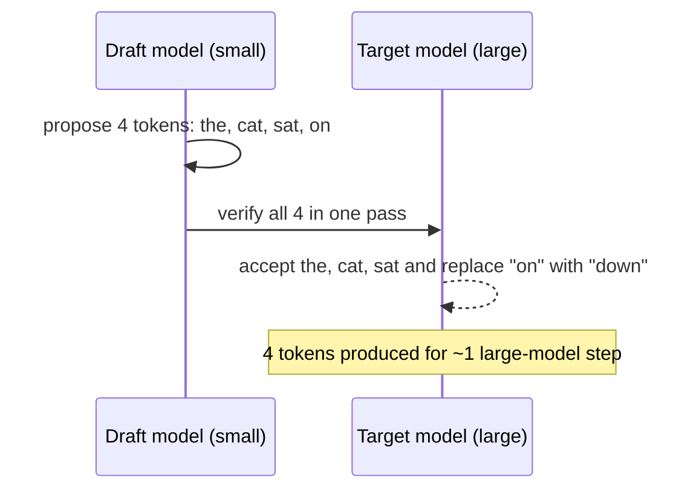

## The problem it solves

Decoding produces one token per forward pass, and each pass is limited by memory bandwidth: the GPU reads all the model's weights to compute just one token per sequence, leaving its compute units mostly idle. For a single user, generating 500 tokens means 500 sequential passes through a huge model.

Verifying several tokens at once costs about the same as generating one, because a forward pass over 5 tokens reads the weights only once. Speculative decoding exploits this.

## How it works

1. A **draft model**, much smaller and faster, generates the next *k* tokens (say 4) on its own.
2. The **target model** (the large one) runs **one** forward pass over all *k* draft tokens, computing what it would have predicted at each position.
3. Draft tokens are accepted left to right as long as they're consistent with the target model's probabilities (using a rejection-sampling rule). At the first rejected token, the target model's own prediction is used instead, and the rest are discarded.
4. Repeat from the new position.

The acceptance rule guarantees the output has **exactly the same distribution** as sampling from the target model alone. It's a pure speed-up, not an approximation.

### Variants

- **Separate draft model:** a small model from the same family (e.g. a 1B draft for a 70B target).
- **Self-speculation:** extra lightweight prediction heads on the target model propose future tokens (Medusa, EAGLE), avoiding a separate model.
- **Prompt lookup / n-gram drafting:** reuse spans from the prompt, which works well for code editing and summarization where output copies input.

## Trade-offs

- **Speed-up depends on the acceptance rate.** Predictable text (code, boilerplate, structured output) accepts more tokens; creative text accepts fewer.
- **Helps latency more than throughput.** At large batch sizes the GPU is already busier, so the spare compute speculative decoding relies on shrinks. It shines for latency-sensitive, low-batch serving.
- **Extra memory and complexity:** the draft model needs its own weights and KV cache, and both models must share a tokenizer.
- **Wasted work** on rejected tokens costs compute.

## In the real world

<Callout type="example" title="Two labs, one idea">
Google researchers (Leviathan, Kalman and Matias) and DeepMind researchers (Chen and colleagues) published speculative decoding independently around the same time. Google reported **2–3× speed-ups** on T5-XXL with identical outputs, and DeepMind reported **2–2.5×** speed-ups decoding Chinchilla 70B in a distributed setup. Major inference engines (vLLM, TensorRT-LLM, SGLang) now support speculative decoding, and many production LLM services use some form of it to speed up streaming.
</Callout>

## Interview angle

<Callout type="interview">
If an LLM feature has strict latency targets and low concurrency (for example, a code completion that must feel instant), mention speculative decoding: a small draft model proposes tokens and the large model verifies them in one pass, giving 2–3× faster generation with identical output.
</Callout>

- Assuming it changes output quality (it doesn't, when implemented correctly).
- Expecting large gains at very high batch sizes.
