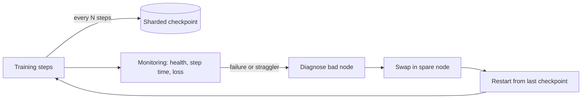

## The problem it solves

Most distributed training is **synchronous**: every GPU must finish its part of a step before any can move on. One failed GPU, a flaky network link or a single slow machine stops or slows **the entire job**.

Failures that are rare per machine become constant at scale. If one GPU fails on average once every few years, a job using 16,000 of them sees a failure every few hours. Without a plan, a months-long training run would rarely make progress.

## How it works

### Checkpointing

Periodically save the full training state (model weights, optimizer state, data loader position, random seeds) so the job can resume from the last checkpoint instead of starting over.

- **How often:** a trade-off between time spent saving and work lost on a failure. Lost work averages half the checkpoint interval.
- **Make it fast:** each GPU writes only its own shard, in parallel, to a high-throughput distributed file system or object store.
- **Asynchronous checkpointing:** copy state to CPU memory quickly, then write it to storage in the background while training continues.
- **In-memory or peer checkpoints:** keep recent state in other nodes' memory for very fast recovery, with less frequent durable copies.

### Detect and replace quickly

- **Health checks** on GPUs, memory, network links and storage, before and during the job.
- **Automatic diagnosis** of which node caused a hang or crash; without it, finding the bad machine among thousands takes hours.
- **Spare capacity:** keep healthy standby nodes ready to swap in.
- **Fast restart:** reload checkpoints, re-initialize communication and resume within minutes.

### Stragglers and silent errors

- A slow GPU (thermal throttling, a degraded link) slows everyone. Monitor per-node step times and replace stragglers.
- **Silent data corruption** (a GPU that computes wrong results without crashing) can poison a run. Watch for loss spikes and NaNs, and validate hardware regularly.

### Measure it

**Effective training time** (or training goodput) is the share of wall-clock time spent making forward progress, excluding time lost to failures, restarts and re-computation. It's the number to optimize.

## Trade-offs

- **Checkpoint frequency** vs overhead and storage cost (checkpoints for large models are terabytes).
- **Spare nodes** cost money while idle, but save far more by shortening restarts.
- **Elastic training** (continuing with fewer GPUs) avoids waiting for replacements but complicates parallelism and reproducibility.
- **Automation is essential:** at this scale, humans can't triage every failure.

## In the real world

<Callout type="example" title="Llama 3: a failure every three hours">
Meta's Llama 3 paper reports that during a **54-day** period of pre-training the 405B model on up to 16,384 H100 GPUs, the job saw **466 interruptions**, of which **419 were unexpected**, about one every three hours. In the paper's breakdown, faulty GPUs were the largest single cause (about 30%), followed by GPU memory (HBM3) at about 17%. Despite this, Meta reported **over 90% effective training time**, with significant manual intervention needed only three times; automation handled the rest. See [How Meta trained Llama 3 on 16,000 GPUs](/case-studies/meta-llama-3-training).
</Callout>

## Interview angle

<Callout type="interview">
In a training-infrastructure question, say failures are routine at scale and describe the recovery loop: sharded asynchronous checkpoints, health monitoring that pinpoints the failed node, spare nodes, and fast automatic restart, measured by effective training time.
</Callout>

- Assuming hardware failures are rare.
- Checkpoints so slow that teams take them too rarely.
