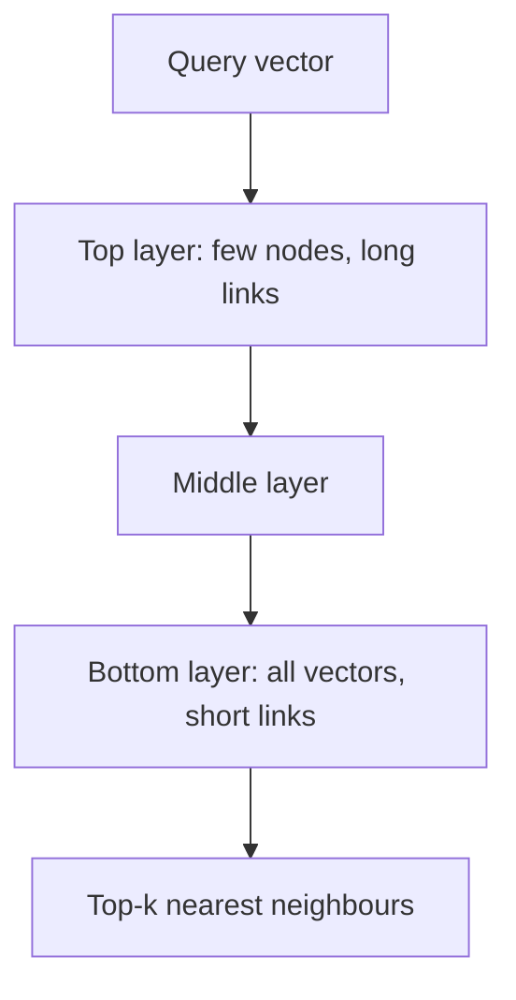

## The problem it solves

Embedding models turn text, images or users into vectors (lists of hundreds to thousands of numbers) where **similar meaning means nearby vectors**. Search, recommendations, deduplication and RAG all come down to one question: which stored vectors are closest to this query vector?

Comparing the query to every stored vector (brute force) is exact but takes time proportional to the dataset size. At hundreds of millions of vectors and thousands of queries per second, that's far too slow.

## How it works

### Similarity

Common measures are **cosine similarity**, **dot product** and **Euclidean distance**. Use the one the embedding model was trained for (many models produce normalized vectors, where cosine and dot product are equivalent).

### Approximate nearest neighbour (ANN) indexes

**HNSW (Hierarchical Navigable Small World)** builds a layered graph where each vector links to its near neighbours. Upper layers are sparse "express lanes"; the bottom layer has every vector. A search starts at the top, greedily moves toward the query, and drops down layer by layer.

- Excellent recall and latency; the most popular choice in vector databases.
- Memory-hungry (vectors plus graph links) and slower to build.

**IVF (inverted file index)** clusters vectors (e.g. with k-means) and, at query time, searches only the few clusters nearest the query (`nprobe`).

- Smaller and faster to build; recall depends on how many clusters you probe.

**Product quantization (PQ)** compresses each vector into a short code (often 8–32× smaller) by splitting it into pieces and quantizing each piece. Often combined with IVF (IVF-PQ) to fit billions of vectors in memory.

### Tuning knobs

Every ANN index trades **recall** (how many of the true nearest neighbours it finds) against **latency** and **memory**: `ef_search` in HNSW, `nprobe` in IVF. Measure recall@k against brute-force results on a sample of real queries.

### Filtering and hybrid search

- Real queries add filters (tenant, language, date, permissions). Filtering after ANN search can return too few results; good systems filter during traversal or partition the index by tenant.
- **Hybrid search** combines vector results with keyword (BM25) results, often merged with reciprocal rank fusion, then reranked.

## Trade-offs

| Index | Recall/latency | Memory | Build/update |
|---|---|---|---|
| Brute force | Exact, slow | Raw vectors | Trivial |
| HNSW | Very good | High | Slower builds; supports inserts |
| IVF | Good (tunable) | Medium | Fast; may need retraining as data shifts |
| IVF-PQ | Lower recall | Very low | Fast; billions of vectors |

- **Dedicated vector database or an extension?** Postgres with pgvector, Elasticsearch/OpenSearch and others now support vector indexes; a separate system adds operational cost but may scale further.
- **Re-embedding:** changing the embedding model means re-embedding everything.
- **Sharding:** large indexes are split across nodes and queried with scatter-gather, like any [sharded](/principles/sharding-and-partitioning) system.

## In the real world

<Callout type="example" title="FAISS">
Meta's **FAISS** library, described in the 2017 paper *Billion-scale similarity search with GPUs*, implements brute force, IVF, PQ, HNSW and their combinations on CPUs and GPUs. The paper showed nearest-neighbour search over **a billion vectors** on GPUs, and FAISS became a foundation for many vector databases and production recommendation and search systems.
</Callout>

HNSW, introduced by Malkov and Yashunin, is the default index in most vector databases today because of its strong recall-latency trade-off.

## Interview angle

<Callout type="interview">
For semantic search or RAG at scale, say: embeddings stored in an HNSW index (or IVF-PQ for billions of vectors), tuned for recall@10 above a target, with metadata filters for tenant and permissions, and hybrid keyword search plus reranking for quality. Mention sharding and re-embedding costs.
</Callout>

- Brute-force search at large scale.
- Applying filters only after retrieving the top k.
