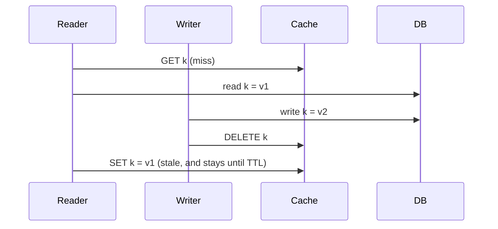

## The problem it solves

> "There are only two hard things in Computer Science: cache invalidation and naming things." (Phil Karlton)

A cache is useful only if it returns correct data, or data that's wrong in a way you've agreed to tolerate. Every write to the source of truth makes some cached values stale. Miss an invalidation, or apply it in the wrong order, and users see old data indefinitely.

## How it works

### Approaches

- **TTL only:** each entry expires after a fixed time. Simple, and the staleness bound is explicit. Every cached value may be up to TTL out of date.
- **Delete on write:** after updating the database, delete the cache key so the next read refills it. Fresher, but the delete can be lost if the process crashes between the two steps.
- **Write-through / update on write:** write the new value into the cache. Risky with concurrent writers: an older value can land last.
- **Event-driven (change data capture):** a separate process tails the database's commit log and deletes or updates cache keys. Invalidation happens even if the app server crashes mid-request.
- **Versioned keys:** include a version in the key (`user:42:v17`), so a new version is a new key and old entries simply age out. Perfect for immutable or fingerprinted content.

### The classic race

The reader's fill arrived after the writer's delete, putting the old value back. Fixes:

- **Leases or tokens:** on a miss, the cache hands the reader a token; a delete invalidates outstanding tokens, so the late SET is rejected. Facebook's memcache uses this.
- **Version checks:** store a version with the value and refuse to overwrite a newer version with an older one.
- **Short TTLs** as a backstop so any leftover staleness heals.

## Trade-offs

| Approach | Freshness | Complexity | Failure mode |
|---|---|---|---|
| TTL only | Bounded by TTL | Lowest | Always somewhat stale |
| Delete on write | Good | Low | Lost deletes, races |
| CDC-driven | Very good | Medium | Pipeline lag or outage |
| Versioned keys | Exact | Medium | Needs a version source |

Multiple layers multiply the problem: an app-local cache, a distributed cache and a CDN each need invalidating, in the right order. See [multi-tier caching](/principles/multi-tier-caching).

## In the real world

<Callout type="example" title="Meta: measuring cache consistency">
In its 2022 post *Cache made consistent*, Meta describes how it raised the consistency of TAO, its graph cache, from about **six nines to ten nines** by one measure. The first step was measurement: a service called **Polaris** acts as a client, watches invalidation events, checks cache replicas for stale values, and rechecks before reporting, so it only flags real, lasting inconsistencies. With that signal, engineers found and fixed rare race conditions in the invalidation pipeline that had been nearly impossible to reproduce.
</Callout>

Facebook's 2013 memcache paper describes the earlier design: invalidations are generated by daemons that read the MySQL commit log, rather than by the web servers that performed the writes, and leases stop stale sets from racing with deletes.

## Interview angle

<Callout type="interview">
When you add a cache, say how it stays correct: "TTL of 5 minutes as a safety net, plus delete-on-write driven from the database's change stream". If the interviewer pushes on races, describe the stale-fill race and a fix like leases or version checks.
</Callout>

- No TTL at all, so a missed invalidation lasts forever.
- Updating the cache before the database commits.
- Forgetting the CDN and app-local caches when invalidating.
