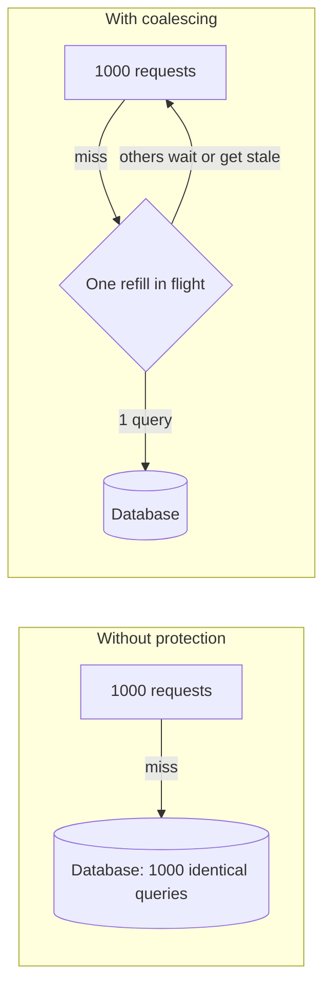

## The problem it solves

A popular key, like the home page feed or a celebrity's profile, is read 10,000 times a second and served entirely from cache. The moment it expires, every one of those requests misses at once and runs the same expensive database query. The database slows down, the query takes longer, more requests pile up behind it, and the cache can't refill. This is a **cache stampede**, also called a thundering herd or dogpile.

The same thing happens at larger scale when a cache cluster restarts or a deploy flushes it: the database suddenly sees all the traffic the cache was hiding.

## How it works



### Techniques

- **Request coalescing (single flight):** within a process or service, only one request for a given key goes to the database; others wait for its result. Go's `singleflight` package does exactly this.
- **Distributed lock or lease:** the first client to miss gets a lease to refill; others back off briefly or use a stale value. Facebook's memcache leases also rate-limit how often a lease is handed out per key.
- **Serve stale while revalidating:** keep the old value past its soft expiry; return it immediately while one background request refreshes. In HTTP this is `Cache-Control: stale-while-revalidate`.
- **Probabilistic early expiration (XFetch):** each reader, as expiry approaches, has a small chance of refreshing early, with the chance growing near expiry and weighted by how long the value takes to compute. Refreshes spread out without coordination.
- **TTL jitter:** add randomness to TTLs so keys written together don't all expire together.
- **Warm the cache** before sending traffic to a new or restarted cluster.

```python
def get(key, ttl, compute, beta=1.0):
    value, delta, expiry = cache.get(key)   # delta = time compute took last time
    # XFetch: refresh early with probability rising as expiry nears
    if value is None or now() - delta * beta * log(random()) >= expiry:
        start = now()
        value = compute()
        cache.set(key, (value, now() - start, now() + ttl))
    return value
```

## Trade-offs

- **Coalescing makes requests wait** on the leader request; set a timeout so a stuck refill doesn't hang everyone.
- **Locks add a dependency** and can deadlock or leak if the holder crashes; use leases with expiry.
- **Stale data must be acceptable** for stale-while-revalidate, which is fine for feeds and catalogs, not for balances.
- **No technique helps if the database can't handle cache-miss traffic at all.** Pair these with [load shedding](/principles/backpressure-and-load-shedding) and gradual cache warm-up.

## In the real world

<Callout type="example" title="Discord: coalescing in front of the database">
Discord's data services, written in Rust, sit between its API and its message database. When a big announcement makes thousands of users open the same channel, the requests are routed by channel ID to the same service instance, which sends **one** query to the database and shares the result with every waiting request. It's stampede protection applied to a database instead of a cache. See [How Discord stores trillions of messages](/case-studies/discord-trillions-of-messages).
</Callout>

Facebook's memcache paper describes leases that solve two problems at once: stale sets (a late write of old data) and thundering herds, since only the lease holder refills a missing key while other clients wait briefly or accept slightly stale data.

## Interview angle

<Callout type="interview">
After adding a cache for a hot key, say what happens when it expires: "we coalesce misses so one request refills it, serve the stale value meanwhile, and add jitter to TTLs". Also mention warming the cache after deploys or restarts.
</Callout>

- Identical TTLs on many keys written at the same time.
- Assuming the cache will always be warm.
