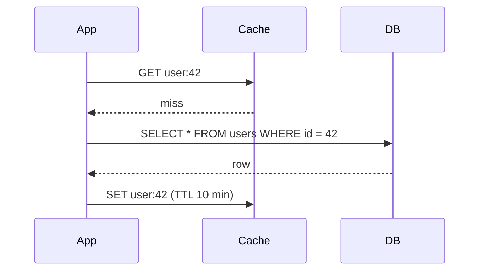

## The problem it solves

Your database can answer a query in 5–20 ms and handle a few thousand queries per second per node. Popular data, like a celebrity profile or a product page on launch day, gets read thousands of times more often than it changes. Sending every one of those reads to the database wastes capacity and adds latency.

A cache keeps a copy of hot data in memory, where a lookup takes well under a millisecond. The hard part isn't storing the copy. It's deciding **who puts data in the cache, when writes reach the database, and how stale a cached value is allowed to be.** Those three choices are what the caching strategies differ on.

## How it works

### Cache-aside (lazy loading)

The application owns the logic. On a read it checks the cache first; on a miss it reads the database and writes the result into the cache. On a write it updates the database and **deletes** the cache key.



```python
def get_user(user_id):
    key = f"user:{user_id}"
    user = cache.get(key)
    if user is None:
        user = db.query_user(user_id)
        cache.set(key, user, ttl=600)
    return user

def update_user(user_id, fields):
    db.update_user(user_id, fields)
    cache.delete(f"user:{user_id}")  # delete, don't set: avoids racing writers
```

This is the most common pattern because the cache only holds data someone actually asked for, and a cache outage degrades to "slow" rather than "down".

### Read-through

Same idea, but the cache library or service loads from the database on a miss, so application code only talks to the cache. DynamoDB Accelerator (DAX) and many ORM-level caches work this way.

### Write-through

Every write goes to the cache and the database together, synchronously. Reads after a write are always fresh, at the cost of slower writes and caching data that may never be read.

### Write-back (write-behind)

Writes go to the cache and are acknowledged immediately; the cache flushes them to the database later, often in batches. Write latency is excellent and the database sees fewer writes, but **a cache node failure can lose acknowledged writes.** CPU caches and some metrics pipelines use it; it's rare for primary business data.

## Trade-offs

| Strategy | Read freshness | Write latency | Risk |
|---|---|---|---|
| Cache-aside | Stale until TTL or delete | Database only | Cold-start misses, race conditions on concurrent writes |
| Read-through | Stale until TTL | Database only | Cache layer becomes a critical dependency |
| Write-through | Fresh | Cache + database | Caches unread data, slower writes |
| Write-back | Fresh in cache | Cache only | Data loss if the cache fails before flushing |

Some rules of thumb:

- **Always set a TTL.** It bounds how wrong a cached value can be when an invalidation is lost.
- **Delete on write rather than set.** Two concurrent writers can otherwise leave the older value in the cache.
- **Plan for the cache being empty.** After a restart or deploy, every request misses at once. See [cache stampede](/principles/cache-stampede).
- **Don't cache what you can't invalidate.** If you can't name the event that makes a value stale, rely on short TTLs instead.

## In the real world

<Callout type="example" title="Meta: memcache in front of MySQL">
Facebook's 2013 NSDI paper describes a cache-aside deployment handling billions of requests per second. They added **leases** so that only one client refills a missing key (fixing both thundering herds and stale sets), and drove invalidations from the MySQL commit log rather than application code, so a deleted key reached every cache cluster even if the web server crashed mid-request.
</Callout>

Amazon's Builders' Library article makes a point that's easy to miss: a cache hides how much load the database can really handle. When the cache fails or is flushed, the full load lands on a database that was never sized for it. Teams either size the database for cache-miss traffic or put [load shedding](/principles/backpressure-and-load-shedding) in front of it.

## Interview angle

<Callout type="interview">
When you add a cache to a design, say which strategy you're using and why, then cover three follow-ups before the interviewer asks: what happens on a write (invalidate vs. update), what TTL you'd pick and what staleness that allows, and what happens when the cache is cold or down.
</Callout>

Common pitfalls:

- Saying "add Redis" without explaining how the data gets there or how it's invalidated.
- Using write-back for data that can't be lost, like orders or payments.
- Forgetting that a cache in front of a sharded database needs its own sharding plan, usually [consistent hashing](/principles/consistent-hashing).
