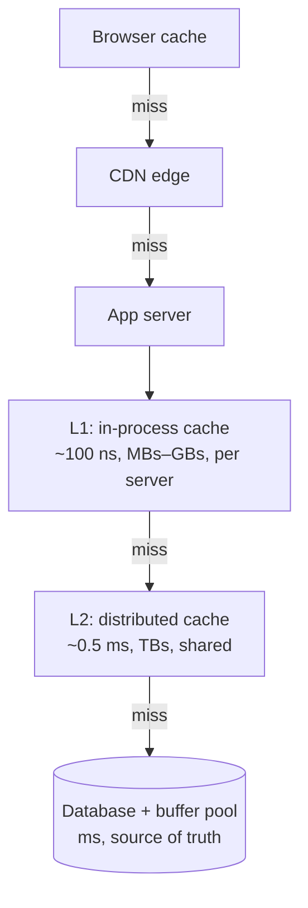

## The problem it solves

No single cache is best at everything. An in-process cache is the fastest possible lookup but is small and private to each server. A distributed cache is shared and large but costs a network round trip. A CDN is closest to the user but only for cacheable HTTP responses. Layering them gets most of each benefit.

## How it works

| Tier | Latency | Size | Shared? | Typical contents |
|---|---|---|---|---|
| Browser / client | 0 network | Small | Per user | Static assets, API responses with cache headers |
| CDN | ~10–50 ms from user | Large | All users near a PoP | Images, video, public pages |
| L1 in-process | ~100 ns | Limited by heap | Per server | Config, hot reference data, small hot objects |
| L2 distributed (Redis, Memcached) | ~0.5–1 ms | Very large | All servers | Sessions, query results, rendered fragments |
| Database buffer pool | Memory speed inside DB | Large | DB only | Hot pages |

### Design rules

- **Each tier needs its own TTL**, usually shorter at the top: an L1 entry of a few seconds, L2 of minutes.
- **Invalidate bottom-up:** update the source, then L2, then L1 and the CDN. Otherwise an upper tier can refill from a stale lower tier.
- **Broadcast L1 invalidations** (pub/sub) or keep L1 TTLs short enough that staleness doesn't matter.
- **Replicate the distributed cache across zones,** or a zone failure turns into a database stampede.

## Trade-offs

- **More layers, more staleness paths.** Every tier is another place old data can hide; debugging "why is this old?" gets harder.
- **L1 caches multiply memory use** (one copy per server) and diverge from each other.
- **Hit rates compound, and so do misses.** If L1 hits 80% and L2 hits 90% of the rest, only 2% of reads reach the database. But a cold L2 sends that 18% straight to the database.

## In the real world

<Callout type="example" title="Meta TAO: a cache built for the social graph">
TAO, described at USENIX ATC 2013, replaced much of Facebook's memcache usage for social graph data. It has two cache tiers: **followers** that serve reads, backed by **leaders** that talk to MySQL and keep the followers consistent. Many follower tiers can serve one leader tier, so reads scale out while only the leaders touch the database. The paper reports TAO serving a billion reads per second and millions of writes per second.
</Callout>

Netflix runs **EVCache**, a distributed memcached-based cache that replicates data across availability zones so each zone reads locally and a zone outage doesn't empty the cache.

Stack Overflow's architecture uses an in-memory cache on each web server as L1 and a shared Redis as L2, with Redis pub/sub to tell every server to drop an L1 entry when data changes.

## Interview angle

<Callout type="interview">
Show the layers explicitly: CDN for static and public content, an L1 for small hot data, Redis/Memcached as the shared cache, then the database. Mention per-tier TTLs and the invalidation order.
</Callout>

- One cache tier doing everything.
- Long L1 TTLs with no way to invalidate them.
